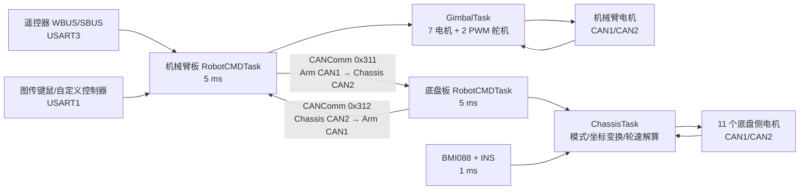
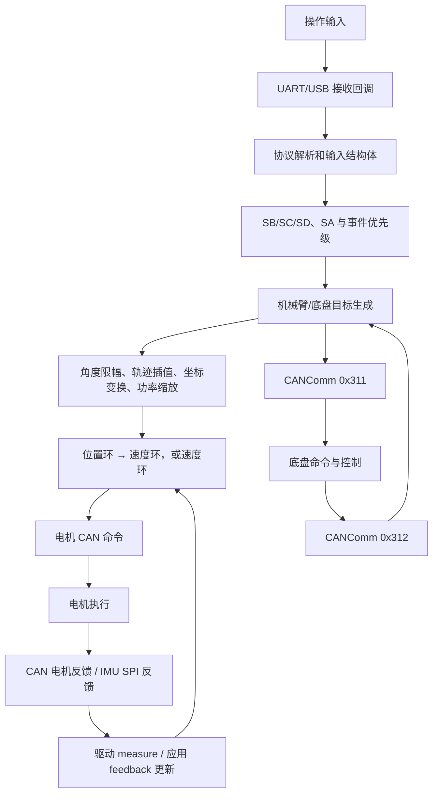
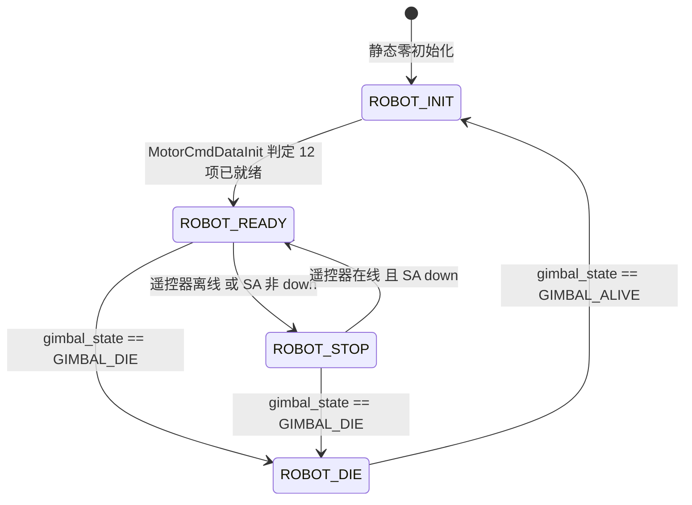
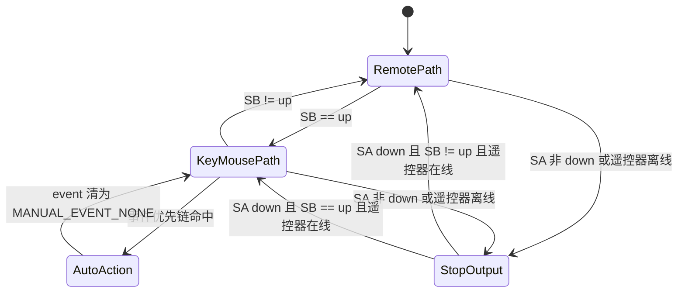

# 第二阶段：系统架构与端到端控制流

> 分析日期：2026-07-22  
> 范围：静态代码分析；未连接、烧录或驱动实机。  
> 证据等级沿用 `README.md` 的 A—D 定义。

## 1. 结论先行

`【已确认｜A级】` 当前系统采用两块 STM32F407 控制板：机械臂板负责接收遥控器和图传键鼠、运行操作模式与机械臂自动动作、控制 7 个机械臂电机和 2 个图传舵机，并以 `0x311` 向底盘板发命令；底盘板以 `0x312` 回传 5 个姿态反馈和事件位，负责 4 个驱动轮、2 个履带、5 个姿态电机以及 IMU 姿态解算。依据为机械臂 `application/cmd/robot_cmd.c:101-141,884-941`、`application/gimbal/gimbal.c:27-439`，以及底盘 `application/cmd/robot_cmd.c:101-148,562-635`、`application/chassis/chassis.c:54-475`。

板间物理外设不是同名 CAN：机械臂端是 `hcan1`，底盘端是 `hcan2`。两端 ID 和结构体长度互补。依据：机械臂 `robot_cmd.c:121-132`；底盘 `robot_cmd.c:121-132`。

## 2. 分层架构

| 层 | 机械臂板 | 底盘板 | 主要接口 | 证据 |
| --- | --- | --- | --- | --- |
| 操作输入 | WBUS/SBUS 遥控器、图传键鼠、自定义控制器；USB Host 仅接收、控制调用注释 | 本地遥控器初始化但活动控制分支注释 | USART DMA/空闲、USB CDC | 机械臂 `remote_control.c:126-162`、`rm_referee.c:182-253`、`robot_cmd.c:884-921`；底盘 `robot_cmd.c:103,606-619`【已确认｜A级】 |
| 命令与模式 | `RobotCMDTask()` 选择遥控/键鼠，运行自动动作、急停、限幅 | `RobotCMDTask()` 解包主板命令并运行底盘自动动作 | `Gimbal_Ctrl_Cmd_s`、`Master_Cmd_Data_s` | 两工程 `application/cmd/robot_cmd.c`【已确认｜A级】 |
| 应用控制 | `GimbalTask()` 将 7 路目标写入电机对象 | `ChassisTask()` 做坐标旋转、四轮解算、功率缩放和 6 路姿态/履带目标分配 | 内存 Message Center | 机械臂 `gimbal.c:352-439`；底盘 `chassis.c:288-475`【已确认｜A级】 |
| 控制器与驱动 | RS、DM、LK 的位置—速度串级或速度环 | DJI 速度环，RS/DM 位置—速度串级 | `PIDCalculate()`、电机任务 | 两工程 `modules/motor/` 和实例配置【已确认｜A级】 |
| 板级通信 | CAN1/CAN2、USART1/3/6、USB、TIM8 PWM | CAN1/CAN2、USART3、SPI IMU | BSP 回调注册 | 两工程 `bsp/` 与应用初始化【已确认｜A级】 |
| 反馈 | 电机角度/速度/力矩/温度；应用回传 7 路角度 | 电机反馈、BMI088/INS；板间回传 5 路姿态 | CAN RX、SPI、发布/订阅 | 机械臂 `gimbal.c:429-439`；底盘 `chassis.c:469-475`【已确认｜A级】 |

## 3. 两块板的职责与连接

`【已确认｜A级】` 两块板的业务角色是命令主站/执行从站，而不是 CAN 协议层面的硬件主从：机械臂发送 `Master_Cmd_Data_s`，底盘发送 `Slave_Upload_Data_s`（两工程 `application/robot_def.h:247-267` 附近）。

## 4. 任务、中断与周期关系

| 执行上下文 | 周期/触发 | 作用 | 数据交接 | 证据 |
| --- | ---: | --- | --- | --- |
| `RobotCMDTask()` + 同一 `RobotTask` 内应用任务 | 名义 5 ms | 两板命令处理；随后机械臂运行 `GimbalTask()`，底盘运行 `ChassisTask()` | Message Center + CANComm | 两工程 `application/robot_task.h:116-127`【已确认｜A级】 |
| `MotorTask` | 1 ms | RS/LK 或 DJI/RS/LK 电机控制发送 | 电机实例中的 `Ref` 和反馈 | 两工程 `robot_task.h:65-75`、`modules/motor/motor_task.c`【已确认｜A级】 |
| `DMTask` | 每次 `osDelay(1)`，轮询实例 | DM 电机控制与发送；单实例实际周期还取决于实例数 | DM 电机实例 | 两工程 `robot_task.h:80-91`、`dmmotor.c`【较可信｜B级】 |
| `INSTask` | 1 ms | BMI088 采样、EKF、姿态输出 | `attitude_t` 共享指针 | 底盘 `robot_task.h:130-140`、`modules/imu/ins_task.c:119-169`【已确认｜A级】 |
| `DaemonTask` | 10 ms | 对遥控器、CANComm、图传、电机在线计数并回调 | 各模块守护实例 | 两工程 `robot_task.h:98-110`【已确认｜A级】 |
| CAN RX ISR → BSP callback | 收到报文 | 电机反馈解包，或 CANComm 多帧组包 | 驱动测量值/协议缓冲区 | `bsp/can/bsp_can.c:176-228`、`can_comm.c:26-70`【已确认｜A级】 |
| UART DMA/空闲 callback | 收到一批串口数据 | 遥控器、图传、裁判数据解析 | 静态输入结构体 | `bsp/usart/bsp_usart.c:108-140`、`remote_control.c:126-145`、`rm_referee.c:191-215`【已确认｜A级】 |

名义频率不等于严格实时频率；`osDelay()` 只给出最短挂起节拍，执行时间和调度会叠加。此处所有“200 Hz/1 kHz”均指代码设计频率，未做逻辑分析仪验证。

## 5. 总体数据流与闭环

机械臂和底盘的详细节点、单位与控制器见 `05-arm-control.md` 和 `06-chassis-control.md`。

## 6. 模式与状态优先级

### 6.1 机器人总状态（机械臂板活动实现）

转换依据：机械臂 `robot_cmd.c:543-612,815-856`。初始化判定中局部变量 `isALLone` 未初始化，故“何时真正进入 READY”存在未定义行为风险，不能等同于可靠的 12 项就绪判定。

### 6.2 操作路径选择

路径选择在机械臂 `RobotCMDTask()` 中先执行输入函数，后执行 `EmergencyHandler()`，所以急停判定在同一 5 ms 周期中覆盖随后发布的模式字段（`robot_cmd.c:896-926`）。但是它不覆盖底盘板在板间失联后继续使用旧命令的情况。

### 6.3 自动动作状态机

机械臂状态为 `MANUAL_STATE / GRAB_STATE / STORE_STATE / RESET_STATE / CLIMB_STATE`，底盘状态为 `MANUAL_STATE / REPOSITION_STATE / CLIMB_STATE`。事件和表项分别见两工程 `modules/fsm/auto_action.h`、`auto_action.c`。

`【已确认｜A级】` 两个 `AutoActionInit()` 都写入 `fsm.size = 47`，但机械臂表只有 24 项、底盘表只有 7 项；`FsmEventHandle()` 按 `size` 遍历。这会在未命中前面合法表项时越界读 `AutoActionTable`，属于高风险内存安全缺陷。依据：机械臂 `auto_action.c:96-137`、底盘 `auto_action.c:44-68`、两工程 `fsm.c:48-61`。

## 7. 模块依赖与数据所有权

| 数据 | 生产者 | 消费者 | 所有权/同步特征 | 评价 |
| --- | --- | --- | --- | --- |
| `Gimbal_Ctrl_Cmd_s` | 机械臂 `RobotCMDTask()` | 同一 `RobotTask` 后续的 `GimbalTask()` | Queue size 1 的自研 Message Center | 顺序调用减少并发，但 `SubGetMessage()` 的 `front_idx = (front_idx++) % QUEUE_SIZE` 写法有未定义/无效自增问题；当前队列长度为 1，影响被掩盖【较可信｜B级】 |
| `Chassis_Ctrl_Cmd_s` | 底盘 `RobotCMDTask()` | 同一任务中的 `ChassisTask()` | 同上 | 活动调用顺序闭合【已确认｜A级】 |
| `Master_Cmd_Data_s` | 机械臂命令任务 | CAN ISR 解包到静态缓冲，底盘命令任务读取 | 无序号、无显式临界区 | CRC 可检错整包，但任务与 ISR 间的 41 字节复制没有快照锁【较可信｜B级】 |
| 电机 `measure` | CAN ISR | 应用任务与电机控制任务 | 普通共享结构体 | 未见统一锁或版本号【较可信｜B级】 |
| `attitude_t` | `INSTask` | `ChassisTask` 与 RS 外部角度反馈 | 普通共享指针 | 未见姿态过期标志【已确认｜A级】 |

## 8. 安全行为摘要

| 级别 | 场景 | 当前代码行为 | 证据 |
| --- | --- | --- | --- |
| P0 | 板间 CAN 命令失联 | 底盘活动路径不调用 `CANCommIsOnline()`，`CANCommLostCallback()` 只复位组包状态，`CANCommGet()` 继续返回旧数据；底盘 `EmergencyHandler()` 调用被注释 | 底盘 `robot_cmd.c:562-624`；`can_comm.c:73-78,126-135`【已确认｜A级】 |
| P0 | 自动动作查表 | `fsm.size=47` 超过实际数组项数，可能越界访问并把随机数据解释为状态表项/函数指针 | 两工程 `auto_action.c` 与 `fsm.c:48-72`【已确认｜A级】 |
| P1 | 图传键鼠失联 | 0.3 s 后仅重启 USART，不清零键鼠状态；遥控器仍在线且 SA 使能时可能继续使用旧按键 | 机械臂 `rm_referee.c:205-253`、`robot_cmd.c:896-905,956-1195`【已确认｜A级】 |
| P0 | 初始化 | 两板 `MotorCmdDataInit()` 的局部 `isALLone` 未初始化，且以反馈值非零作为“收到反馈”条件；底盘还可超时强制完成 | 两工程 `robot_cmd.c:815-856` / `516-543`【已确认｜A级】 |
| P0 | 底盘未初始化分支 | `motor_init_finish==0` 时仍使能四个驱动电机并采用收到的 `vx/vy/wz`，未检查 STOP | 底盘 `chassis.c:431-445`【已确认｜A级】 |
| P1 | 部分机械臂电机失联 | `GimbalAliveCheck()` 只在 4 个被检查电机全部离线时判 DIE，且未覆盖 3 个电机 | 机械臂 `gimbal.c:320-347`【已确认｜A级】 |
| P2 | 模式切换 | 没有统一的目标斜坡或全部 PID 积分清零；不同驱动 STOP 行为不一致 | 各电机驱动 `Stop()`/控制函数【较可信｜B级】 |
| P2 | 功率缩放 | `LimitChassisOutput()` 循环 4 次调用本身已遍历四轮并缩放目标的 `calfromPID()`，可能重复四次衰减 | 底盘 `chassis.c:300-315`、`power_control.c:90-131`【已确认｜A级】 |
| P0 | 自动爬台退出 | `uint8_t delay_time` 与 `<300` 比较使退出分支不可达，`start_track` 可能持续保持 | 底盘 `auto_action.c:207-249`、`robot_cmd.c:504-508`【已确认｜A级】 |
| P1 | PID 数学实现 | 控制器对浮点误差/输出使用整数 `abs()`，影响死区、积分与饱和逻辑 | 两工程 `modules/algorithm/controller.c:29-43,149-209`【已确认｜A级】 |

这些是静态代码风险分级，不是实机事故结论，也不是本阶段的修复提交。

## 9. 证据链断点

- 电机命令能够追踪到 CAN 报文写入 BSP，但仓库没有电机厂商完整协议手册与实机总线抓包，因此“驱动器收到后如何闭环执行”停在接口边界。【代码中未确认｜D级】
- 代码可确认四轮轮速关系与变量符号，但物理轮型、坐标轴贴纸和电机装配方向仍需机械图/实机确认。【较可信｜B级】
- 遥控器通道名和数值方向可确认，物理面板标签、手感方向以及 SA/SB/SC/SD 的实际安装方向未确认。【代码中未确认｜D级】
- 所有周期均来自 `osDelay` 和代码注释，尚无示波器、RTOS trace 或 CAN 抓包验证。【较可信｜B级】
