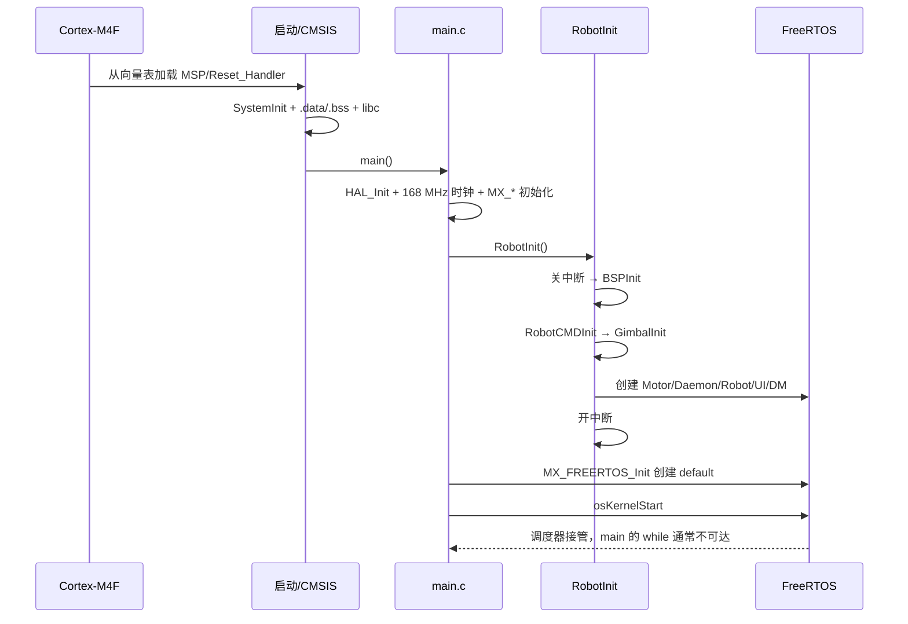
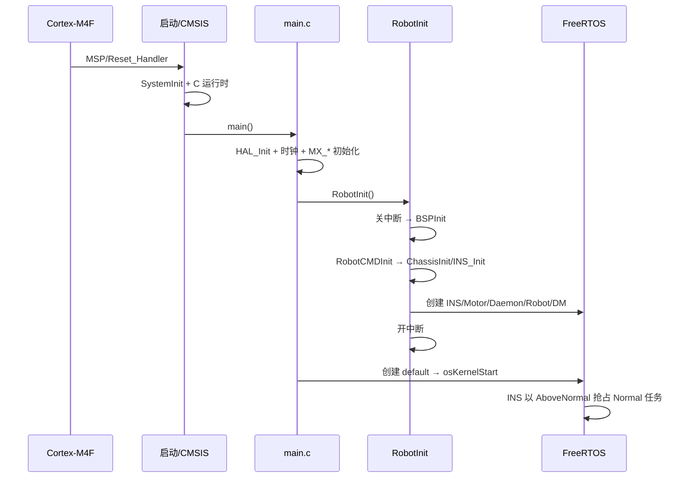
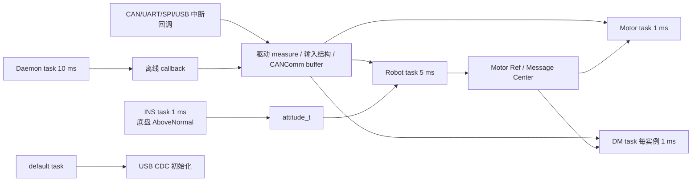

# 启动流程、FreeRTOS 与中断协作

> 面向 STM32/FreeRTOS 初学者。所有周期均为代码设计值，未用逻辑分析仪或 RTOS trace 实测。

## 1. 从复位到 `main()`

### 代码事实

两个工程使用同一类 STM32F407 GCC 启动文件。向量表第 0 项是 `_estack`，第 1 项是 `Reset_Handler`；复位处理先设置 MSP、调用 `SystemInit()`，再把 Flash 中的 `.data` 初值复制到 RAM、把 `.bss` 清零、调用 `__libc_init_array()`，最后进入 `main()`。依据：两工程 `startup_stm32f407xx.s:57-100` 与 `STM32F407IGHx_FLASH.ld`。

| 阶段 | 机械臂函数/符号 | 底盘函数/符号 | 作用 | 来源 |
| --- | --- | --- | --- | --- |
| 复位向量 | `_estack`, `Reset_Handler` | 同名 | 硬件从向量表装载 MSP 和 PC | ST 启动文件 |
| 系统早期初始化 | `SystemInit()` | 同名 | CMSIS 设置 FPU/向量表/早期时钟状态 | ST CMSIS |
| C 运行时 | `.data/.bss`, `__libc_init_array` | 同名 | 建立全局/静态变量初值，运行构造器 | 启动文件 + libc |
| C 入口 | `main()` | `main()` | HAL、时钟、外设、业务与 RTOS 初始化 | CubeMX 框架 + USER CODE |

### 原理解释

`.data` 是“有非零初值的全局/静态变量”，镜像在 Flash、运行时在 RAM；`.bss` 是“初值为 0 的全局/静态变量”。因此 `robot_state` 等未显式赋值的静态对象上电为 0，并对应枚举首项 `ROBOT_INIT`。栈顶由链接脚本的 `_estack` 给出，不是 FreeRTOS 各任务栈；任务栈是在创建任务时另行分配。

### 改进建议

- 初学者不要在启动汇编或链接脚本中尝试“修控制逻辑”；先在 `main()`、`RobotInit()` 和应用层建立断点。
- 若排查“进不了 main”，再检查 MSP、复位向量、Flash 地址和 `Reset_Handler`，不要先调整 PID。

## 2. `main()` 与设备初始化

### 代码事实

两工程顶层 `Src/main.c:80-142` 顺序完全相同：

1. `HAL_Init()`；
2. `SystemClock_Config()`；
3. `MX_GPIO_Init()`、`MX_DMA_Init()`；
4. USART1、CAN1、CAN2、USART6、RTC、CRC、RNG、ADC1、DAC、I²C2/3、SPI1/2、TIM1/4/5/8/10、USART3、TIM6；
5. `RobotInit()`；
6. `MX_FREERTOS_Init()` 创建 default task；
7. `osKernelStart()`。

时钟配置使用 HSE，PLLM=6、PLLN=168、PLLP=2，得到 168 MHz SYSCLK；AHB=168 MHz、APB1=42 MHz、APB2=84 MHz（两工程 `Src/main.c:155-204`）。

`RobotInit()` 在关闭全局中断期间运行 `BSPInit()`、业务实例初始化和 `OSTaskInit()`，再开中断（两工程 `application/robot.c:18-32`）。`BSPInit()` 只初始化 168 MHz DWT 和日志；CAN/UART/SPI 等实例在模块注册时启动服务（`bsp/bsp_init.h:16-20`）。

| 项目初始化 | 机械臂 | 底盘 | 证据 |
| --- | --- | --- | --- |
| 命令层 | `RobotCMDInit()` | `RobotCMDInit()` | 两工程 `robot.c:27` |
| 机械应用 | `GimbalInit()` | 不活动 | 机械臂 `robot.c:28-29` |
| 底盘应用 | 不活动 | `ChassisInit()` | 底盘 `robot.c:28-29` |
| 业务任务 | Motor、Daemon、Robot、UI、DM | INS、Motor、Daemon、Robot、DM | 两工程 `robot_task.h:37-57` |
| CubeMX task | default/USB | default/USB | `Src/freertos.c:83-130` |

### 原理解释

`MX_*_Init()` 只配置 MCU 外设寄存器、GPIO 和 DMA；“某个设备能工作”还需要项目模块注册回调。例如 `MX_CAN1_Init()` 不等于电机已注册，真正的过滤器和接收分发在 `CANRegister()` 中建立。

`RobotInit()` 在调度器前创建任务是允许的：`osThreadCreate()` 会创建就绪任务，但只有 `osKernelStart()` 后才调度。关闭中断能避免初始化一半时收到 CAN/UART 数据；代价是初始化函数不能依赖普通中断或 RTOS 延时。代码注释也明确要求只使用 DWT 延时。

### 改进建议

- `RobotInit()` 中每个 `osThreadCreate()` 和每个 `malloc()` 都应检查失败返回；当前没有统一检查。
- BMI088 初始化使用 `while (BMI088Init(...) != OK);` 忙等。硬件故障会使底盘永远停在调度器启动前，应在未来增加有限重试和明确故障状态。

## 3. 两个工程启动时序

### 机械臂

### 底盘

## 4. CubeMX 文件和修改边界

| 文件/区域 | 可以怎样修改 | 不建议做法 | 原因 |
| --- | --- | --- | --- |
| `Engineer.ioc` | 经评审后用 CubeMX 6.12.1 修改外设 | 文本手改后再让 CubeMX 覆盖 | `.ioc:242,469` 显示版本与 KeepUserCode |
| `Src/main.c`, `Src/freertos.c`, `Src/*外设.c` | 只在 `USER CODE BEGIN/END` 中放项目代码 | 在生成区写长期逻辑 | 重新生成可能覆盖 |
| `application/`, `bsp/`, `modules/` | 项目自研代码可正常维护 | 把设备业务塞入 HAL IRQ 文件 | 分层和可测试性变差 |
| `Drivers/`, `Middlewares/` | 只升级受控版本或查接口 | 直接修改 HAL/FreeRTOS 内核来规避应用 bug | 后续难以合并厂商更新 |
| `Core/`, `USB_DEVICE/` | 当前仅作重复树对照 | 把修复写到这里并认为已生效 | Makefile 不编译这些路径 |

## 5. 活动任务清单

CMSIS-RTOS v1 的 `osThreadDef` 栈参数最终作为 FreeRTOS stack depth 使用；Cortex-M4 的 `StackType_t` 为 4 B，所以下表同时列“参数值”和约合字节数。没有运行时 high-water-mark 数据，不能证明这些栈足够。

### 机械臂镜像：6 个任务

| 任务 | 周期线索 | 优先级 | 栈参数（约字节） | 输入 | 输出 | 共享数据 | 主要调用 |
| --- | ---: | --- | ---: | --- | --- | --- | --- |
| `StartMOTORTASK` | `osDelay(1)` | Normal | 512（2048 B） | RS/LK Ref 与 CAN feedback | RS/LK CAN 命令 | 电机实例 | `MotorControlTask()` |
| `StartDAEMONTASK` | `osDelay(10)` | Normal | 128（512 B） | daemon 计数 | 离线回调、蜂鸣器 | daemon 链表 | `DaemonTask()`, `BuzzerTask()` |
| `StartROBOTTASK` | `osDelay(5)` | Normal | 1024（4096 B） | 遥控、图传、反馈 | 机械臂目标、板间命令 | Message Center、命令结构 | `RobotCMDTask()`, `GimbalTask()` |
| `StartUITASK` | `UITask()` 内发送可能阻塞，末尾 `osDelay(1)` | Normal | 1024（4096 B） | UI/裁判数据 | USART6 UI 帧 | `ui_data` 等 | `UITask()` |
| `DMMotorTask` | 每实例后 `osDelay(1)` | Normal | 128（512 B） | 两个 DM Ref/feedback | DM CAN 命令 | DM 实例数组 | 位置/速度 PID、`CANTransmit()` |
| `defaultTask` | `osDelay(1)` | Normal | 128（512 B） | 无 | 首次调用初始化 USB CDC | USB 全局状态 | `MX_USB_DEVICE_Init()` |

### 底盘镜像：6 个任务

| 任务 | 周期线索 | 优先级 | 栈参数（约字节） | 输入 | 输出 | 共享数据 | 主要调用 |
| --- | ---: | --- | ---: | --- | --- | --- | --- |
| `StartINSTASK` | `osDelay(1)` | AboveNormal | 1024（4096 B） | BMI088 SPI 数据 | `attitude_t`、加热 PWM | 静态 `INS` | `INS_Task()`, `VisionSend()` |
| `StartMOTORTASK` | `osDelay(1)` | Normal | 512（2048 B） | DJI/RS Ref 与反馈 | 电机 CAN 命令 | 电机实例 | `MotorControlTask()` |
| `StartDAEMONTASK` | `osDelay(10)` | Normal | 128（512 B） | daemon 计数 | 离线回调、蜂鸣器 | daemon 链表 | `DaemonTask()`, `BuzzerTask()` |
| `StartROBOTTASK` | `osDelay(5)` | Normal | 1024（4096 B） | 板间命令、电机/IMU反馈 | 11 路目标、板间反馈 | 命令、Message Center | `RobotCMDTask()`, `ChassisTask()` |
| `DMMotorTask` | 每实例后 `osDelay(1)` | Normal | 128（512 B） | 两个 DM Ref/feedback | DM CAN 命令 | DM 实例数组 | PID、`CANTransmit()` |
| `defaultTask` | `osDelay(1)` | Normal | 128（512 B） | 无 | 初始化 USB CDC | USB 状态 | `MX_USB_DEVICE_Init()` |

任务依据：两工程 `application/robot_task.h:37-140`、`modules/motor/DMmotor/dmmotor.c:276-375`、`Src/freertos.c:83-130`。

## 6. 调度、漂移与任务关系

### 代码事实

- `configTICK_RATE_HZ=1000`，抢占开启，总优先级 7，Heap 15,360 B（`FreeRTOSConfig.h:59-73`）。
- `INCLUDE_vTaskDelayUntil=0`，全部周期任务使用 `osDelay()`。
- 没有活动的 FreeRTOS queue、mutex、semaphore、event group、notification 或 software timer；Message Center 是自研内存队列。
- 未配置 `configCHECK_FOR_STACK_OVERFLOW`，未找到 `vApplicationStackOverflowHook()` 或 `vApplicationMallocFailedHook()`。
- `osThreadCreate()` 返回值、驱动层 `malloc()` 返回值普遍未检查。

### 原理解释

`osDelay(T)` 表示“从调用时刻再至少睡 T tick”，所以实际周期约为：

$$T_{period}=T_{execute}+T_{delay}+T_{schedule}$$

它会随执行时间漂移。`vTaskDelayUntil()` 才是相对固定基准的周期唤醒，但当前配置明确禁用。机械臂 DM 任务每次只处理一个实例再 delay 1 ms；两个实例各自约 2 ms，而不是每台严格 1 ms。

### 任务关系图

### 典型底盘控制时间轴

```mermaid
gantt
    title 名义时间轴（非实测、会漂移）
    dateFormat X
    axisFormat %L ms
    section 高优先级
    INS 采样/EKF           :0, 1
    INS 下一轮             :2, 3
    section Normal
    Motor PID/CAN          :0, 1
    DM 实例0               :1, 2
    DM 实例1               :3, 4
    RobotCMD + Chassis     :0, 5
    Daemon                 :0, 10
```

### 改进建议

- 未来在不改控制含义的独立变更中启用固定周期 API，并记录任务最坏执行时间；不能只替换 API 而不验证控制器 `dt` 与总线负载。
- 使用 `uxTaskGetStackHighWaterMark()`、运行时统计和 stack overflow hook 给栈大小提供证据。
- 底盘 INS 为唯一高于 Normal 的业务任务；若它忙等或运行过长，可推迟所有 Normal 任务。当前 BMI088 读取为任务内同步流程，应实测耗时。

## 7. 中断、DMA 与回调

| 中断或回调 | 触发源 | 修改数据 | 消费任务 | 同步方式 | 潜在风险 |
| --- | --- | --- | --- | --- | --- |
| `CAN1/2_RX0/1_IRQHandler` | bxCAN FIFO pending | HAL 内部状态 | — | `HAL_CAN_IRQHandler()` | ISR 频率受高 CAN 负载影响 |
| `HAL_CAN_RxFifo*MsgPendingCallback` | HAL CAN 分发 | CANInstance buffer；电机 `measure` 或 CANComm buffer | Robot/Motor/DM | 普通内存，无 RTOS 通知/锁 | 遍历实例、在 ISR 内解析；多字节快照竞态 |
| `USART1/3/6_IRQHandler` + DMA streams | UART IDLE/错误/DMA完成 | HAL/DMA 状态 | — | HAL 回调 | 同一缓冲复用 |
| `HAL_UARTEx_RxEventCallback` | Receive-to-idle DMA 事件 | 遥控、图传、裁判结构；随后清接收缓冲 | Robot/UI | 普通内存，无队列 | 忽略 `Size` 传给模块；解析在回调上下文执行 |
| `HAL_UART_ErrorCallback` | parity/overrun/frame 等 | 重启 DMA 接收 | 后续输入消费者 | 无显式通知 | 只恢复接收，不统一清旧数据 |
| `DMA2_Stream0/3` + SPI callbacks | SPI1 DMA 完成 | BMI088/SPI 实例 buffer | INS task/驱动 | callback + 共享 buffer | SPI BSP 有忙等待；指针生命周期由调用者保证 |
| `EXTI3/4/9_5` | BMI088 MAG/ACC/GYRO 引脚 | GPIO callback 数据（若注册） | 设备模块 | 回调表 | 当前 INS 仍由任务主动读，数据就绪中断未用于唤醒任务 |
| `OTG_FS_IRQHandler` → CDC receive | USB FS 包 | 2048 B USB buffer、Host recv | Robot（但 Host 控制不活动） | 回调、普通内存 | USB FS 单包 64 B；Host RX 长度检查不足 |
| `TIM8_TRG_COM_TIM14_IRQHandler` | TIM8/TIM14 | HAL timer 状态/timebase | HAL/RTOS | HAL handler | 应保持短小；业务控制不在此处 |
| HardFault/MemManage/BusFault/UsageFault | CPU fault | 无诊断快照 | 无 | 无限循环 | 不保存 stacked PC/LR/CFSR，复盘困难 |

入口依据：两工程 `Src/stm32f4xx_it.c:90-430`；分发依据 `bsp/can/bsp_can.c:176-228`、`bsp/usart/bsp_usart.c:108-156`、`bsp/spi/bsp_spi.c`、`bsp/usb/bsp_usb.c`。

### 原理解释

DMA 让外设直接把字节搬到 RAM，CPU 不必为每个字节进入中断；UART IDLE 适合变长帧，在总线空闲时通知“一批数据到了”。但 DMA 不自动解决并发：ISR/回调写结构体、任务同时读结构体，仍可能读到一半新一半旧的数据。

`volatile` 只能阻止编译器省略某些内存访问，不能让 41 B `memcpy` 原子化，也不能替代互斥、临界区、双缓冲或版本号。当前关键共享结构大多不是 `volatile`，也没有统一快照同步。

### 改进建议

- ISR 中只做取帧、轻量校验和写入快照；复杂状态机、轨迹和控制继续放在任务中。
- 对 CANComm、输入帧和电机反馈采用“写入影子缓冲 → 临界区交换索引/版本号”的模式，并记录更新时间。
- 回调若要唤醒任务，应使用 FromISR API；当前项目没有这样做，不能在文档中假称已有信号同步。

## 8. 共享数据与并发风险

| 共享对象 | 写入者 | 读取者 | 当前保护 | 结论 |
| --- | --- | --- | --- | --- |
| 各电机 `measure` | CAN ISR callback | Motor/DM/Robot task | 无锁 | 多字段一致性未保证【较可信｜B级】 |
| 各电机 `pid_ref` | Robot task | Motor/DM task | 无锁 | 32-bit 对齐 float 单次写通常原子，但目标与模式组合不是事务【较可信｜B级】 |
| `unpacked_recv_data` | CAN ISR | Robot task | CRC 后 memcpy，无快照锁 | 21/41 B 可能被并发读取【较可信｜B级】 |
| `RC_ctrl_t`, `ImgTrans_info_t` | UART callback | Robot task | 无锁 | 可能读到跨帧组合；失联清理不一致【已确认｜A级】 |
| `attitude_t` | AboveNormal INS task | Normal Robot/Motor task | 无锁 | 多轴姿态可能不是同一更新时刻【较可信｜B级】 |
| PID 辅助静态变量 | 多个任务的 `PIDCalculate()` | 同函数 | `f_Integral_Limit()` 内两个 `static float` | 函数不可重入；高优先级 INS 温控可抢占 Normal 电机 PID【已确认｜A级】 |

没有活动互斥锁，所以没有经典“持锁导致的优先级反转”；真正风险是未同步共享内存。Message Center queue size=1，且 Robot task 内生产者/消费者顺序调用，降低了跨任务竞争，但其实现不应被误认为 FreeRTOS Queue。

