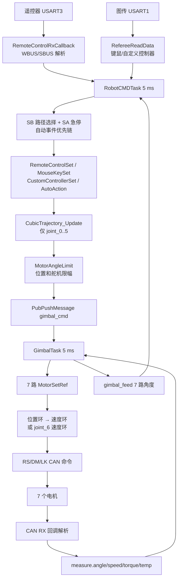

# 机械臂控制链路

> “关节”名称按代码通道而非机械装配命名。除能由驱动配置确认的电机型号和总线外，本文使用 `joint_0`—`joint_6`，避免臆测物理关节名称。

## 1. 控制方式摘要

`【已确认｜A级】` 机械臂应用有 7 个电机控制通道和 2 个 PWM 图传舵机。`joint_0..5` 是位置目标，分别采用角度—速度串级闭环；`joint_6` 虽存放在 `target_arm_angle[6]`，实际配置为 LK4005 速度环，用于夹持/末端动作。配置见 `application/gimbal/gimbal.c:27-310`，目标分配见 `gimbal.c:352-397`。

- 目标生成：遥控器、键鼠、自定义控制器或自动动作，名义 5 ms 更新一次。
- 轨迹：六自由度三次多项式；只对 `joint_0..5` 生效。
- 控制器：RS/DM/LK 驱动内的位置—速度串级或速度单环。
- 发送：RS 与 LK 由 1 ms `MotorTask` 控制；两台 DM 由轮询 `DMTask` 控制，单电机名义约 2 ms 一次。
- 反馈：CAN 回调更新电机 `measure`，`GimbalTask()` 汇总 7 路反馈后发布给下一控制周期。
- 未发现活动的正/逆运动学、重力补偿、摩擦补偿或前馈配置。

## 2. 端到端链路

## 3. 控制链节点表

| 链路节点 | 输入 | 处理函数 | 输出 | 单位 | 执行上下文 | 名义周期 | 代码依据 |
| --- | --- | --- | --- | --- | --- | ---: | --- |
| 遥控器接收 | 25 B UART 数据 | `RemoteControlRxCallback()` → `wbus_to_rc()`/`sbus_to_rc()` | `RC_ctrl_t` | 原始计数 | USART 回调 | 约 14 ms 注释值 | `remote_control.c:9,35-145`【已确认｜A级】 |
| 图传接收 | A5 裁判帧或 A9 53 键鼠帧 | `ImgTransRxCallback()` → `RefereeReadData()` | 键鼠/控制器结构 | 鼠标计数、键位、原始 float | USART 回调 | 发送端决定 | `rm_referee.c:102-185,205-253`【已确认｜A级】 |
| 输入选择 | `RC_ctrl_t`、键鼠 | `RobotCMDTask()` | 选择 `RemoteControlSet()` 或 `MouseKeySet()` | — | `RobotTask` | 5 ms | `robot_cmd.c:884-910`【已确认｜A级】 |
| 自动事件 | 通道阈值/按键上升沿 | `AutoActionEventTransfer()` | `EVENT_ID` | — | `RobotTask` | 5 ms | `robot_cmd.c:617-683`【已确认｜A级】 |
| 自动轨迹 | 当前反馈、waypoint | `CubicTrajectory_Init/Update()` | `traj.pos[6]` | rad | `RobotTask` | 5 ms 更新 | `auto_action.c:145-205`、`trajectory_planning.c:12-91`【已确认｜A级】 |
| 目标限幅 | `target_arm_angle[]` | `MotorAngleLimit()` | 限幅后的 6 路位置目标 | rad | `RobotTask` | 5 ms | `robot_cmd.c:858-881`【已确认｜A级】 |
| 模式安全 | 在线状态、SA、机械臂状态 | `EmergencyHandler()` | STOP/ENABLE、目标保持 | — / rad | `RobotTask` | 5 ms | `robot_cmd.c:543-612`【已确认｜A级】 |
| 目标分发 | `Gimbal_Ctrl_Cmd_s` | `GimbalTask()` | 各电机 `Ref` | rad；joint_6 rad/s | `RobotTask` | 5 ms | `gimbal.c:352-397`【已确认｜A级】 |
| RS 控制 | 角度/速度目标和反馈 | `RSMotorControlMIT()` | 力矩命令 | rad、rad/s、N·m | `MotorTask` | 1 ms | `RSmotor/rsmotor.c:56-165,244-335`【已确认｜A级】 |
| DM 控制 | 角度/速度目标和反馈 | `DMMotorControlMIT()` | MIT 力矩/增益字段 | rad、rad/s、N·m | `DMTask` | 轮询，单台约 2 ms | `DMmotor/dmmotor.c:89-118,321-363`【较可信｜B级】 |
| LK 控制 | 角度或速度目标和反馈 | `LKMotorControl()` | A1 电流命令 | rad、rad/s、电流协议值 | `MotorTask` | 1 ms | `LKmotor/LKmotor.c:107-192`【已确认｜A级】 |
| 反馈汇总 | 各电机 `measure` | `GimbalTask()` | `feedback_arm_angle[7]` | rad | `RobotTask` | 5 ms | `gimbal.c:429-439`【已确认｜A级】 |

## 4. 关节—电机—CAN 映射

| 逻辑关节 | 电机对象/类型 | CAN 总线 | 命令/逻辑 ID | 反馈匹配 ID | 反馈变量 | 目标变量 | 控制器 | 可信度 |
| --- | --- | --- | --- | --- | --- | --- | --- | --- |
| `joint_0` | `arm_06_1` / RS | CAN1 | 扩展帧逻辑 ID 2 | 扩展 ID 低字节 `0x12` | `measure.angle` | `target_arm_angle[0]` | 角度→速度→力矩 | 【已确认｜A级】 |
| `joint_1` | `arm_04_2` / RS | CAN2 | 扩展帧逻辑 ID 3 | 低字节 `0x13` | `measure.angle` | `[1]` | 角度→速度→力矩 | 【已确认｜A级】 |
| `joint_2` | `arm_06_3` / RS | CAN2 | 扩展帧逻辑 ID 4 | 低字节 `0x14` | `measure.angle` | `[2]` | 角度→速度→力矩 | 【已确认｜A级】 |
| `joint_3` | `arm_4310_4` / DM4310 | CAN2 | 标准 ID 5 | 标准 ID `0x15` | `measure.angle` | `[3]` | 角度→速度→MIT torque | 【已确认｜A级】 |
| `joint_4` | `arm_4310_5` / DM4310 | CAN2 | 标准 ID 6 | 标准 ID `0x16` | `measure.angle` | `[4]` | 角度→速度→MIT torque | 【已确认｜A级】 |
| `joint_5` | `arm_4005_6` / LK4005 | CAN2 | 逻辑 ID 7 → `0x147` | `0x147` | `measure.total_angle` | `[5]` | 角度→速度→电流 | 【已确认｜A级】 |
| `joint_6` | `arm_4005_7` / LK4005 | CAN2 | 逻辑 ID 8 → `0x148` | `0x148` | 应用上传 `total_angle`；闭环使用速度 | `[6]` | 速度→电流 | 【已确认｜A级】 |

依据：`gimbal.c:27-287`；ID 变换见相应 `RSmotor`、`DMmotor`、`LKmotor` 初始化和 CAN 回调。DM 的模式命令使用 `0x105/0x106`，正常 MIT 控制使用目标标准 ID 5/6（`gimbal.c:146-217`、`dmmotor.c`）。

`img_pitch` 和 `img_yaw` 不是上述关节电机：它们分别通过 TIM8 CH2/CH3 PWM，周期 0.02 s，初始化 duty 0.075/0.095（`gimbal.c:289-310`）。

## 5. 目标来源与优先顺序

1. `RobotCMDTask()` 先读取反馈并更新轨迹。
2. SB up 时先 `MouseKeySet()`，再 `AutoActionHandler()`；否则执行 `RemoteControlSet()`。
3. `ChassisEventHandler()` 处理板间事件握手。
4. `EmergencyHandler()` 在输入处理后覆盖 STOP/ENABLE，并在 STOP 时把目标设为当前反馈。
5. `GrabberAction()` 可覆盖 `target_arm_angle[6]`。
6. `MotorAngleLimit()` 最后限制 `joint_0..5` 和舵机目标，再发布。

依据：`robot_cmd.c:884-926`。因此同一周期内，Emergency 的模式优先级高于普通输入；夹持速度目标在 Emergency 之后运行，需要结合 `GimbalTask()` 的 STOP 标志才保证不输出，而不是目标变量本身必然为零。

## 6. 位置限制、滤波与轨迹

| 通道 | 限制 | 单位 | 依据 |
| --- | ---: | --- | --- |
| joint_0 | `[-3.10, 3.10]` | rad | `robot_cmd.c:858-867`【已确认｜A级】 |
| joint_1 | `[-1.47, 1.39]` | rad | 同上 |
| joint_2 | `[-2.43, 2.94]` | rad | 同上 |
| joint_3 | `[-3.14, 3.14]` | rad | 同上 |
| joint_4 | `[-1.57, 1.57]` | rad | 同上 |
| joint_5 | `[-3.14, 3.14]` | rad | 同上 |
| joint_6 | 无集中限幅 | 速度目标 | `MotorAngleLimit()` 未处理索引 6【已确认｜A级】 |
| 图传 yaw | `[0.05, 0.13]` | PWM duty | `robot_cmd.c:875-880`【已确认｜A级】 |
| 图传 pitch | `[0.055, 0.09]` | PWM duty | 同上 |

自定义控制器有 0.05/0.95 一阶平滑；手动遥控器关节增量没有独立低通，仅依靠每周期小增量。三次轨迹的段时长按六关节最大差值计算：小于 0.8 rad 使用 0.5 rad/s，否则 1.8 rad/s，并加 0.1 s（`trajectory_planning.c:12-34`）。轨迹速度 `traj.vel` 被计算但未送入电机前馈。

## 7. 运动学、前馈与补偿

| 项目 | 结论 | 依据/等级 |
| --- | --- | --- |
| 关节坐标控制 | 活动路径直接增量/赋值 `target_arm_angle[]` | `robot_cmd.c:271-499,956-1195`【已确认｜A级】 |
| 末端坐标控制 | 存在被注释的 IK 代码块，但当前不执行 | `RemoteControlSet()` SC up 分支附近【已确认｜A级】 |
| 正运动学/逆运动学 | 仓库有算法痕迹，但活动机械臂链未调用 | 全仓调用搜索【已确认｜A级】 |
| 轨迹规划 | 六自由度三次多项式，自动动作和自定义控制器使用 | `auto_action.c`、`trajectory_planning.c`【已确认｜A级】 |
| 重力补偿 | 未发现活动实现或配置 | 活动调用和电机配置搜索【代码中未确认｜D级】 |
| 摩擦补偿 | 未发现活动实现或配置 | 同上【代码中未确认｜D级】 |
| 速度/力矩前馈 | 驱动框架支持部分前馈字段，但这些实例未配置活动前馈 | `motor_def.h` 与 `gimbal.c` 配置【已确认｜A级】 |

## 8. 反馈闭环

| 反馈量 | 来源 | 接收/解析 | 保存变量 | 单位 | 使用者 | 过期检测 |
| --- | --- | --- | --- | --- | --- | --- |
| RS 角度/速度/力矩/温度 | 3 台 RS | CAN 扩展帧回调 | `RSMotorInstance.measure` | rad、rad/s、N·m、°C | 位置/速度环、反馈上传 | daemon 约 300 ms；控制函数会检查在线【已确认｜A级】 |
| DM 角度/速度/力矩/温度/错误码 | 2 台 DM4310 | CAN 标准帧回调 | `DMMotorInstance.measure` | rad、rad/s、N·m、°C | 位置/速度环、反馈上传 | daemon 约 50 ms；解析的错误码未进入上层安全状态【已确认｜A级】 |
| LK 编码器/单圈角/累计角/速度/电流/温度 | 2 台 LK4005 | A1 CAN 回包 | `LKMotorInstance.measure` | rad、rad/s、协议电流、°C | 位置或速度环、反馈上传 | daemon 约 50 ms，但 `LKMotorControl()` 未据在线状态停止【已确认｜A级】 |

LK 驱动以 16-bit 编码器差值阈值 32768 处理回绕，并累计 `total_angle`（`LKmotor.c` 的反馈回调）。方向符号由各实例的 `motor_reverse_flag` 和驱动控制代码应用；当前机械臂配置未统一记录机械零点偏置到驱动层，自动 waypoint/初始化目标直接依赖收到的角度。

## 9. 停止与异常输出

`GimbalTask()` 在 STOP 模式调用 7 个电机的 Stop，然后仍保存目标引用；ENABLE 时全部 Enable。电机发送任务根据各自 stop 标志输出零/停机命令。依据：`gimbal.c:352-413`。

主要缺口：

| 场景 | 当前处理 | 最终输出判断 | 评价 |
| --- | --- | --- | --- |
| 遥控器离线/SA 非 down | 约 100 ms 清零遥控器；下一命令周期设 STOP | 正常软件路径下 7 路停止 | 有软件覆盖，但无硬件断能【较可信｜B级】 |
| 单个机械臂电机离线 | `GimbalAliveCheck()` 不一定进入 DIE；只对 4 台中的“全部离线”判 DIE | 其余目标可能继续输出 | P1【已确认｜A级】 |
| LK 反馈过期 | lost callback 仅记录，控制任务继续用旧反馈 | 可能继续闭环发送 | P1【已确认｜A级】 |
| 模式切换 | 无统一全部积分清零；RS Stop 只清部分积分，DM/LK 行为不同 | 恢复时可能有瞬态 | P2【较可信｜B级】 |
| 图传失联 | 仅重启 USART，不清键鼠 | SA 仍使能时旧输入可能继续生效 | P1【已确认｜A级】 |
| 自动动作 | 状态表大小越界 | 行为不可可靠预测 | P0【已确认｜A级】 |
| PID 小误差/限幅 | `controller.c` 对 float 使用整数 `abs()` | 31 个活动 PID 的死区、积分和饱和行为可能偏离设计 | P1【已确认｜A级】 |

证据链在电机驱动器固件和真实机械执行处中断，后续需用厂商协议、总线抓包和断能台架验证；本阶段不做实机测试。

## 10. 教学与最终审查补充

**代码事实：** 机械臂 13 个活动 PID 环的参数、公式和重置差异已汇总到 [08-control-algorithms.md](08-control-algorithms.md)。仓库虽有 `ForwardKinematics()` / `InverseKinematics()`，当前命令路径调用被注释；三次轨迹的 `vel[6]` 也没有作为速度前馈下送。【已确认｜A级】

**原理解释：** 机械臂当前是关节空间控制：上游给六个位置和一个末端速度，驱动内用位置—速度串级或速度单环追踪。存在运动学源文件不等于整机正在做末端坐标控制。

**改进建议：** 初学者先沿 `RobotCMDTask()` → `GimbalTask()` → 单个电机驱动 → CAN 回调完成一条通道的单位追踪。调参、运动学接入和自动动作实机验证均应在 P0/P1 修复、独立评审和断能验证后进行；驱动阅读见 [09-hardware-drivers.md](09-hardware-drivers.md)，最终风险见 [11-safety-analysis.md](11-safety-analysis.md) 与 [14-code-quality-review.md](14-code-quality-review.md)。
