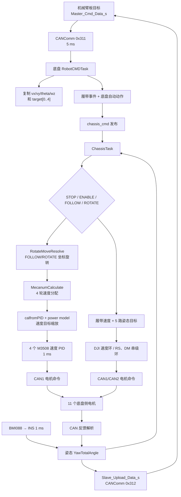

# 底盘控制链路

## 1. 控制方式摘要

`【已确认｜A级】` 底盘板的活动控制命令只来自机械臂板的 CANComm `0x311`。本地遥控器虽然初始化，但 `RobotCMDTask()` 中本地控制分支被注释。底盘每 5 ms 解包命令、运行姿态自动动作并发布；随后 `ChassisTask()` 选择 STOP/ENABLE/FOLLOW/ROTATE，将平移和旋转量解算为四个 M3508 速度目标，经过功率模型缩放后送入速度 PID。同时控制 2 个履带 M3508、2 个 DM 摇臂、2 个 RS 后腿和 1 个 RS 转向/姿态电机。

四轮关系是典型的四轮全向/麦克纳姆式符号组合，但仓库没有轮型照片或装配图。可确认“代码按麦克纳姆命名并使用四轮全向解算”，不能仅凭固件完全确认真实机械结构。【较可信｜B级】

## 2. 端到端控制流程



## 3. 板间命令到控制量

| 控制量 | 来源 | 底盘变量 | 单位 | 转换函数 | 限制 | 最终作用 |
| --- | --- | --- | --- | --- | --- | --- |
| 前后/轴向分量 | `Master_Cmd_Data_s.vx` | `chassis_cmd_send.vx` → `chassis_vx` | 代码未标定；直接混入电机 rpm 目标 | ENABLE 直通；FOLLOW/ROTATE 经 `RotateMoveResolve()` | 键鼠/遥控器生成端有限制，底盘侧无统一限幅 | 4 个驱动轮速度组合【已确认｜A级】 |
| 横向分量 | `.vy` | `chassis_vy` | 同上 | 同上 | 同上 | 4 轮速度组合【已确认｜A级】 |
| 旋转分量 | `.wz` | `chassis_wz` | 代码未标定 | ENABLE 直通；FOLLOW 用 PID；ROTATE 固定 4000 | FOLLOW PID `MaxOut=9000` | 4 轮差速项【已确认｜A级】 |
| 参考朝向 | `.theta_z` | `chassis_cmd_send.theta_z` | 未使用 | 相关 IMU PID 代码注释 | 无活动限制 | 当前无最终作用【已确认｜A级】 |
| 摇臂目标 | `target[0..1]` | 同名数组 | rad | 自动轨迹/直通 | 仅 [0] `[0.05,5.8]`、[1] `[-5.8,-0.05]` | 2 个 DM4310 位置环【已确认｜A级】 |
| 后腿目标 | `target[2..3]` | 同名数组 | rad | 自动轨迹/直通 | 底盘侧限幅已注释；机械臂生成端有限幅 | 2 个 RS 位置环【已确认｜A级】 |
| 姿态/方向目标 | `target[4]` | 同名数组 | rad | RS 外部角度反馈使用 IMU `YawTotalAngle` | 机械臂生成端未统一环绕处理 | RS 位置—速度环【已确认｜A级】 |
| 履带速度 | 事件位 | `target[5]` | rpm 目标 | inverse=-4000，forward=+4000，否则 0 | 固定三值 | 两个履带 M3508【已确认｜A级】 |

底盘 `RobotCMDTask()` 先单独复制枚举，再 `memcpy(..., 9*sizeof(float))`，对应 4 个速度/角度 float 和 `target[0..4]`；第 6 个目标由事件生成（`application/cmd/robot_cmd.c:562-594`）。

## 4. 模式逻辑

| 模式 | 进入字段 | 平移处理 | 旋转处理 | 电机行为 | 证据 |
| --- | --- | --- | --- | --- | --- |
| STOP | `CHASSIS_MODE_STOP` | `vx=vy=0` | `wz=0` | `motor_init_finish` 为真时 Stop 全部 11 台 | `chassis.c:362-400`【已确认｜A级】 |
| ENABLE | `CHASSIS_MODE_ENABLE` | `vx/vy` 直通 | `wz` 直通 | Enable 全部 11 台 | `chassis.c:401-409`【已确认｜A级】 |
| FOLLOW | `CHASSIS_MODE_FOLLOW` | 按 `arm_04_0->measure.angle` 旋转坐标 | `PID(rad_format(angle), 0)` | Enable 全部 11 台 | `chassis.c:410-414,336-349`【已确认｜A级】 |
| ROTATE | `CHASSIS_MODE_ROTATE` | 同样旋转坐标 | 固定 `4000` | Enable 全部 11 台 | `chassis.c:415-418`【已确认｜A级】 |

FOLLOW 的旋转 PID 参数为 Kp -600、Kd -30、最大输出 9000（`chassis.c:255-265`）。虽然底盘初始化把 `arm_04_0` 的角度环反馈指向 IMU `YawTotalAngle`，FOLLOW 的平移坐标旋转和 `chassis_wz_PID` 使用的却是该 RS 电机自身 `measure.angle`；两者不是同一个反馈量（`chassis.c:132-168,336-343,410-414`）。

## 5. 轮速解算与坐标系

源文件声明平面右手系：纵向正前方为 x 正，右侧为 y 正（`chassis.c:1-9`）。轮速分配为：

```text
lf =  vx + vy + wz * LF_CENTER
rf =  vx - vy + wz * RF_CENTER
lb = -vx + vy + wz * LB_CENTER
rb = -vx - vy + wz * RB_CENTER
```

依据：`chassis.c:288-294`。`WHEEL_BASE=400`、`TRACK_WIDTH=377`、`RADIUS_WHEEL=60`，但四轮式中半径和周长并未参与当前换算；所以 `vx/vy/wz` 更像直接缩放到 rpm 目标的控制量，不能文档化为 m/s 或 rad/s。【已确认｜A级】

FOLLOW/ROTATE 使用：

```text
vx_body = cos(a)*vx_cmd + sin(a)*vy_cmd
vy_body = -sin(a)*vx_cmd + cos(a)*vy_cmd
```

其中 `a=rad_format(arm_04_0->measure.angle)`（`chassis.c:336-349`）。代码中存在 `if (vx==0 & vy==0)`，使用按位 `&` 而非逻辑 `&&`；对两个比较结果仍可得到 0/1，但没有短路语义。

## 6. 电机映射

| 逻辑对象 | 电机对象/类型 | CAN | 逻辑/命令 ID | 反馈 ID | 目标/控制器 | 可信度 |
| --- | --- | --- | --- | --- | --- | --- |
| 左前驱动 | `motor_lf` / M3508 | CAN1 | 1，组命令 `0x200` | `0x201` | 速度 PID | 【已确认｜A级】 |
| 右前驱动 | `motor_rf` / M3508 | CAN1 | 2，`0x200` | `0x202` | 速度 PID | 【已确认｜A级】 |
| 左后驱动 | `motor_lb` / M3508 | CAN1 | 4，`0x200` | `0x204` | 速度 PID | 【已确认｜A级】 |
| 右后驱动 | `motor_rb` / M3508 | CAN1 | 3，`0x200` | `0x203` | 速度 PID | 【已确认｜A级】 |
| 左履带 | `motor_track_l` / M3508 | CAN1 | 5，组命令 `0x1FF` | `0x205` | 速度 PID，反向配置 | 【已确认｜A级】 |
| 右履带 | `motor_track_r` / M3508 | CAN1 | 6，`0x1FF` | `0x206` | 速度 PID | 【已确认｜A级】 |
| 姿态/方向 | `arm_04_0` / RS | CAN2 | 扩展逻辑 ID 5 | 低字节 `0x15` | 外部 IMU 角度→电机速度→力矩，反向 | 【已确认｜A级】 |
| 左后腿 | `motor_leg_lb` / RS | CAN2 | 扩展逻辑 ID 9 | 低字节 `0x19` | 角度→速度→力矩 | 【已确认｜A级】 |
| 右后腿 | `motor_leg_rb` / RS | CAN2 | 扩展逻辑 ID 10 | 低字节 `0x1A` | 角度→速度→力矩 | 【已确认｜A级】 |
| 左前摇臂 | `motor_rocker_lf` / DM4310 | CAN2 | 标准 ID 1 | `0x11` | 角度→速度→MIT torque | 【已确认｜A级】 |
| 右前摇臂 | `motor_rocker_rf` / DM4310 | CAN2 | 标准 ID 2 | `0x12` | 角度→速度→MIT torque | 【已确认｜A级】 |

依据：`chassis.c:61-253`、底盘 `modules/motor/DJImotor/dji_motor.c` 的分组规则以及 RS/DM 驱动 ID 规则。

## 7. 功率限制与速度闭环

四轮解算结果先写入 `PowerControl_t.speed_rpm_set[4]`，速度反馈来自四台 M3508。`calfromPID()` 根据各速度 PID 的 Kp/Ki、当前速度和最大输出估算电流模型系数；`chassis_power_control()` 以固定 `chassis_power_set=105` 计算预测功率并用统一比例 `limit_k` 缩放四轮速度目标，随后才调用 `DJIMotorSetRef()`（`chassis.c:300-321`、`power_control.c:27-131`）。

两个重要限制：

1. 裁判系统实时功率、电容和比赛功率上限没有接入该活动路径；模型上限固定为 105。【已确认｜A级】
2. `LimitChassisOutput()` 用 `for (i=0;i<4;i++) calfromPID(power_limit)`，但 `calfromPID()` 自己已遍历四轮并缩放一次。因此一次 5 ms 应用周期可能连续缩放四次，属于 P2 算法实现风险。【已确认｜A级】

四台 M3508 的速度 PID Kp=15、Ki=0、最大输出 15000；电机控制任务每 1 ms 计算并以组报文发送电流型命令（`chassis.c:61-113`、`dji_motor.c:263-327`）。

## 8. 自动姿态/爬台状态机

底盘自动事件来自主板事件位：`CHASSIS_REPOSITION`、`CHASSIS_CLIMB`、`CHASSIS_REFORMAT`。状态机的复位轨迹覆盖 4 个姿态通道；爬台轨迹分两段，并读取两个 DM 当前力矩判断阶段推进（`application/cmd/robot_cmd.c:461-508`、`modules/fsm/auto_action.c:36-201`）。

`【已确认｜A级】` 当前 `fsm.size=47`，实际表只有 7 项；事件查找存在越界读取。在修复和验证前，任何自动爬台/复位行为都不可视为可靠。

## 9. 反馈闭环

| 反馈量 | 来源 | 接收/解析 | 保存变量 | 单位 | 使用控制器/上层 | 更新线索 |
| --- | --- | --- | --- | --- | --- | --- |
| 4 轮/2 履带编码器、速度、电流、温度 | M3508 | DJI CAN 回调 | `measure.ecd/total_angle/speed_rpm/real_current/temperature` | 编码计数、deg、rpm、协议电流、°C | 四轮速度 PID；履带速度 PID | CAN 帧；daemon 20 ms【已确认｜A级】 |
| 2 个摇臂角/速/力矩/温度 | DM4310 | DM CAN 回调 | `measure` | rad、rad/s、N·m、°C | 位置—速度串级；爬台力矩判断 | daemon 约 100 ms（`reload_count=10`）【已确认｜A级】 |
| 2 个后腿角/速/力矩/温度 | RS | RS CAN 回调 | `measure` | rad、rad/s、N·m、°C | 位置—速度串级 | daemon 300 ms【已确认｜A级】 |
| IMU yaw/累计 yaw | BMI088 + INS | SPI 采样、EKF | `attitude_t.Yaw/YawTotalAngle` | rad | `arm_04_0` 外部角度环；板间反馈[4] | INS task 1 ms【已确认｜A级】 |
| 板间姿态反馈[0..4] | 上述 DM/RS/IMU | `ChassisTask()` 汇总 | `feedback_chassis_angle[]` | rad | 机械臂目标初始化、STOP 目标保持 | 5 ms 发送【已确认｜A级】 |

`EstimateSpeed()` 目前为空，因此回传结构中没有由轮速和 IMU 计算出的实际 `vx/vy/wz`（`chassis.c:323-333`）。反馈过期方面，电机守护回调多只记录日志；INS 没有活动的姿态过期守护。控制器可能继续使用旧反馈。【已确认｜A级】

## 10. 失能与安全行为

| 风险场景 | 检测条件 | 当前处理 | 最终输出 | 初步评价 |
| --- | --- | --- | --- | --- |
| 正常收到 STOP 且初始化完成 | `chassis_mode==STOP` | Stop 11 台并置 `vx/vy/wz=0` | 驱动按 stop 标志发送零/停止命令 | 正常软件链闭合【已确认｜A级】 |
| 板间 CAN 失联 | daemon 约 500 ms 可检测 | callback 仅清组包状态；活动任务不查询在线 | 旧命令持续进入控制链 | P0【已确认｜A级】 |
| `motor_init_finish==0` | 初始化未完成 | 仍 Enable 4 个驱动轮并直通 `vx/vy/wz` | 可能运动 | P0【已确认｜A级】 |
| 单个电机反馈失联 | 各驱动 daemon | 多数只日志；没有集中使底盘 STOP | 其他路径继续运行，部分驱动可能用旧反馈 | P1【已确认｜A级】 |
| IMU 数据陈旧/异常 | 未见活动检测 | 继续作为外部角度反馈 | 姿态环可能基于旧值 | P1【较可信｜B级】 |
| 模式切换 | 枚举字段改变 | 直接切换坐标变换/固定旋转/PID | 目标可能突变；无统一积分清零 | P2【已确认｜A级】 |
| 多任务发送 | 电机种类各自由对应任务发送 | 同一电机类型由单一控制任务管理 | 未发现两个业务任务直接发送同一电机正常命令 | 较低，但 DM 重使能命令需单独审计【较可信｜B级】 |

代码中存在某种轮速解算关系，但仅凭当前仓库不能完全确认实际机械结构。证据链在电机驱动器固件、轮地接触和真实坐标方向处中断。

## 11. 第三阶段教学补充

**代码事实：** 底盘共有 18 个活动 PID 环；四轮/履带是速度单环，其余关节为位置—速度串级，另有 FOLLOW 相对角 PID 和 BMI088 温控 PID。活动四轮解算没有使用 `RADIUS_WHEEL`，`theta_z` 与 IMU 世界坐标控制代码也被注释。【已确认｜A级】

**原理解释：** `vx/vy/wz` 是直接混入电机目标的代码量，不能在没有换算链时标成 m/s 或 rad/s；FOLLOW 是相对机械角坐标旋转，不是 IMU 世界坐标跟随。

**改进建议：** 初学者先离线代入四组速度组合验证轮速符号，再沿单个 DJI 反馈—速度 PID—组 CAN 帧追踪。最终审查确认功率模型可能每周期重复缩放四次（P2）、板间失联保留旧命令（P0），且未初始化分支仍使能四轮（P0）；处理并验证这些问题前不做实机试车。详见 [11-safety-analysis.md](11-safety-analysis.md)。
