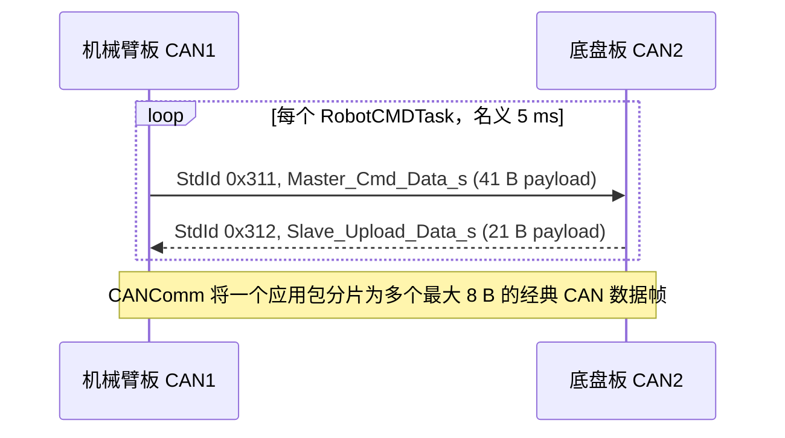

# 通信协议与证据

## 1. 协议清单

当前可确认 9 类协议/封装：板间 CANComm、DJI 电机 CAN、RS 电机 CAN、DM 电机 CAN、LK 电机 CAN、遥控器 WBUS/SBUS、裁判/自定义控制器 A5 协议、A9 53 键鼠协议、USB Host 简单二进制协议。其中 USB Host 的控制消费路径被注释；HC-05 等驱动虽存在，但没有进入当前活动初始化，不计入活动协议数量。

| 协议 | 物理接口 | 活动方向 | 校验/完整性 | 在线/超时 | 证据等级 |
| --- | --- | --- | --- | --- | --- |
| CANComm | CAN1（机械臂）↔ CAN2（底盘） | 双向 | 应用帧头/长度/CRC8/帧尾 | 约 500 ms daemon，但未接入安全停机 | 【已确认｜A级】 |
| DJI 电机 | 底盘 CAN1 | 命令/反馈 | CAN 帧本身；无额外应用 CRC | 约 20 ms daemon | 【已确认｜A级】 |
| RS 电机 | 两板 CAN1/CAN2 | 命令/反馈 | CAN 帧本身 | 约 300 ms daemon | 【已确认｜A级】 |
| DM 电机 | 两板 CAN2 | 命令/反馈 | CAN 帧本身 | 机械臂约 50 ms；底盘约 100 ms daemon | 【已确认｜A级】 |
| LK 电机 | 机械臂 CAN2 | 命令/反馈 | CAN 帧本身 | 约 50 ms daemon | 【已确认｜A级】 |
| WBUS/SBUS | USART3, 100000 bit/s | 遥控器→板 | 帧格式/范围检查；代码未见独立 CRC | 约 100 ms，清零遥控结构 | 【已确认｜A级】 |
| 裁判/自定义 A5 | 机械臂 USART1, 921600 bit/s | 双向定义，接收活动 | 帧头 CRC8 + 全帧 CRC16 | 图传约 300 ms；丢失不清数据 | 【已确认｜A级】 |
| A9 53 键鼠 | 机械臂 USART1 | 图传→机械臂 | 当前分支只检查两字节头，未校验 CRC | 同上 | 【已确认｜A级】 |
| USB Host | USB FS CDC | 双向定义，接收活动 | RX 只检查 `0xAB`；TX 对 24 B 角度算 CRC16 | 约 50 ms，只日志 | 【已确认｜A级】 |

串口速率依据两工程 `Engineer.ioc:586-589`；CAN 位时序在 42 MHz APB1、Prescaler 3、BS1 10TQ、BS2 3TQ 下对应 1 Mbit/s，依据 `.ioc:12-29` 和时钟配置。【已确认｜A级】

## 2. 板间通信

### 2.1 拓扑与报文表

| 报文 ID | 总线 | 发送方 | 接收方 | 单帧 DLC 序列 | 应用 payload | 数据类型/单位 | 周期 | 超时 |
| --- | --- | --- | --- | --- | ---: | --- | ---: | ---: |
| `0x311` | Arm CAN1 → Chassis CAN2 | 机械臂 | 底盘 | 8,8,8,8,8,5 | 41 B | 4 个 float 控制量、5 个 float 姿态目标、4 B enum、1 B event；角度为 rad，速度量未物理标定 | 5 ms | 约 500 ms daemon，未触发停机 |
| `0x312` | Chassis CAN2 → Arm CAN1 | 底盘 | 机械臂 | 8,8,8,1 | 21 B | 5 个 float 姿态反馈 + 1 B event；角度为 rad | 5 ms | 约 500 ms daemon，未触发停机 |

依据：机械臂 `application/cmd/robot_cmd.c:121-132,939-941`；底盘 `robot_cmd.c:121-132,562-635`；`application/robot_def.h:247-267`；`modules/can_comm/can_comm.c:26-135`。

### 2.2 CANComm 应用封装

每个完整应用包格式为：

| 偏移 | 长度 | 内容 |
| ---: | ---: | --- |
| 0 | 1 | `'s'` (`CAN_COMM_HEADER`) |
| 1 | 1 | payload 长度 |
| 2 | N | packed payload |
| 2+N | 1 | `crc_8(payload, N)` |
| 3+N | 1 | `'e'` (`CAN_COMM_TAIL`) |

CANComm 逐个固定 ID CAN 帧拼接，只有长度、尾字节和 CRC8 全部通过才把 payload 复制到 `unpacked_recv_data` 并 reload daemon（`can_comm.h:20-22`、`can_comm.c:26-70`）。没有包序号、分片序号或发送时戳。

### 2.3 `0x311` 字节定义

结构体使用 `#pragma pack(1)`；当前 GNU Arm 工具链未启用 `-fshort-enums`，因此枚举按 4 B 处理，payload 为 41 B。

| payload 偏移 | 长度 | 字段 | 类型 | 单位/含义 |
| ---: | ---: | --- | --- | --- |
| 0 | 4 | `vx` | float32 LE | 底盘控制量，未标定物理单位 |
| 4 | 4 | `vy` | float32 LE | 同上 |
| 8 | 4 | `theta_z` | float32 LE | 当前底盘活动路径未使用 |
| 12 | 4 | `wz` | float32 LE | 旋转控制量，未标定物理单位 |
| 16—35 | 20 | `target_chassis_angle[0..4]` | 5×float32 LE | rad |
| 36—39 | 4 | `chassis_mode` | GCC enum LE | STOP/ENABLE/FOLLOW/ROTATE |
| 40 | 1 | `event` | uint8 | 事件位图 |

事件位：bit0 START_TRACK、bit1 CHASSIS_REPOSITION、bit2 CHASSIS_CLIMB、bit3 CHASSIS_REFORMAT、bit4 CHASSIS_INIT_FINISH、bit5 CHASSIS_FSM_BUSY、bit6 START_TRACK_INVERSE（两工程 `robot_def.h:237-245` 附近）。

### 2.4 `0x312` 字节定义

| payload 偏移 | 长度 | 字段 | 类型 | 单位/含义 |
| ---: | ---: | --- | --- | --- |
| 0—19 | 20 | `feedback_chassis_angle[0..4]` | 5×float32 LE | [0..1] DM 摇臂 rad；[2..3] RS 后腿 rad；[4] INS `YawTotalAngle` rad |
| 20 | 1 | `event` | uint8 | 初始化完成、FSM busy 等反馈位 |

发送方和接收方对当前字段数量、顺序与事件位的解释一致，未发现用户要求定义的 P1 字段不一致。【已确认｜A级】 但协议直接传 C 枚举和本机 float，ABI 依赖较强；若未来更换编译器、启用 short-enum 或改变结构体定义而只更新一端，会破坏兼容性。【较可信｜B级】

### 2.5 超时与一致性

- `daemon_count=50`，Daemon 任务每 10 ms，故完整有效应用包约 500 ms 未到即回调。
- `CANCommLostCallback()` 只把 `recv_state` 和当前长度清零，不清 `unpacked_recv_data`。
- `CANCommGet()` 无条件返回最后缓冲区并清 update flag；调用方不检查返回是否为新包。
- 两板活动命令任务都不调用 `CANCommIsOnline()`；底盘 `EmergencyHandler()` 调用被注释。

因此板间命令超时不会自动产生零目标或 STOP，是 P0 安全缺口。依据：`can_comm.c:73-78,126-135`、底盘 `robot_cmd.c:562-624`。

## 3. 遥控器 WBUS/SBUS

UART 接收长度固定 25 B。回调以首字节 `0x0F` 且第 24 字节为 0 选择 WBUS，否则走 SBUS（`remote_control.c:126-135`）。WBUS 将 11-bit J1—J4、SA—SD 和 dial 减 1024；标称原始范围 364—1684。前五个通道绝对值超过 671 时清零（`remote_control.c:23-29,97-116`、`remote_control.h:31-47`）。

SBUS 分支还解析鼠标 x/y/z、左右键和 16-bit 键盘位图（`remote_control.c:35-94`），但当前主要操作逻辑使用 WBUS 命名字段及单独图传键鼠结构。约 100 ms 无新帧时 `RCLostCallback()` 清零整个遥控结构并重启 USART（`remote_control.c:141-162`）。

## 4. 图传、裁判与自定义控制器

### 4.1 A5 帧

解析要求 SOF `0xA5`、5 B 头 CRC8 正确、整帧 CRC16 正确；命令 ID 位于字节 5—6，数据从偏移 7 开始（`rm_referee.c:102-179`）。

| 命令 ID | 方向 | 长度 | 保存位置 | 使用情况 |
| --- | --- | ---: | --- | --- |
| `0x0302` | 自定义控制器→机器人 | 30 B | `ControllerToRobot.data[30]` | 前 24 B 作 6 个 float 目标；末 6 B 中复制 keypad 数据；F 模式开启时进入控制【已确认｜A级】 |
| `0x0309` | 机器人→自定义控制器 | 30 B | `RobotToController.data[30]` | 接收与发送函数存在；活动周期发送调用未确认【较可信｜B级】 |
| 其他裁判 ID | 裁判系统→机器人 | 按协议枚举 | `referee_info_t` | USART6 裁判/UI 初始化活动；底盘功率控制未使用实时裁判功率【已确认｜A级】 |

`ImgTransSendControllerData()`/`ImgTransSendRobotData()` 构造 A5 头、序号、CRC8、CMD ID、30 B 数据和 CRC16（`rm_referee.c:270-331`）。函数注释中“自定义控制器→机器人”的发送方向与机器人端函数位置容易混淆，应以实际调用者和线缆端点验证。【较可信｜B级】

### 4.2 A9 53 键鼠帧

若缓冲首两字节为 `0xA9 0x53`，代码从偏移 10 复制 11 B 到 `key_mouse_t`，随后按 Ctrl/Shift 分类并统计上升沿（`rm_referee.c:34-70,182-185`）。该分支没有在当前函数中验证长度或 CRC；USART 接收缓冲为 255 B，实际有效长度没有传给 `RefereeReadData()`。这是输入完整性风险。【已确认｜A级】

图传守护约 300 ms。丢失回调只重启 USART 并记录日志，不清 `KeyMouseRaw/KeyMouseData/key_count/ControllerToRobot`，所以旧输入可保留。【已确认｜A级】

## 5. USB Host 协议

| 方向 | 格式 | 校验 | 活动性 |
| --- | --- | --- | --- |
| Host→机械臂 | 字节 0=`0xAB`；字节 1—24=6×float32 LE | RX 不验证 CRC，也不检查 `recv_len>=25` | `HostInit()` 活动；`HostControlSet()` 调用注释 |
| 机械臂→Host | `0xAC` + 6×float32 当前角度 + CRC16 | CRC16 只覆盖 24 B 角度，不含头 | `HostSend()` 存在；`RobotCMDTask()` 调用注释 |

依据：`modules/master_machine/host_communication.h:6-27`、`.c:41-86`，以及 `application/cmd/robot_cmd.c:506-536,921,947`。daemon 约 50 ms，离线回调仅日志。

## 6. 电机 CAN 协议

### 6.1 DJI M3508/C620

底盘驱动轮 ID 1—4 使用组命令标准 ID `0x200`，履带 ID 5—6 使用 `0x1FF`。每台电机占组报文连续 2 B，大端 int16 输出；反馈 ID=`0x200+电机逻辑 ID`，8 B 中包含编码器、rpm、当前、电温。反馈以 4096 阈值处理 8192 计数回绕（底盘 `dji_motor.c:16-28,156-179,329-346`）。

### 6.2 RS

活动模式使用扩展帧 MIT 风格命令：8 B 依次为 16-bit position、16-bit velocity、16-bit Kp、16-bit Kd；目标 torque 编码在扩展 ID 数据字段中。范围宏定义和反馈解析把角度、速度、力矩、温度还原为 rad、rad/s、N·m、°C（`RSmotor/rsmotor.c:56-85,167-200`、`rsmotor.h`）。

### 6.3 DM4310

MIT 命令 8 B：P16、V12/Kp 高 4 bit、Kp 低 8 bit、Kd12/T 高 4 bit、T 低 8 bit。反馈解析 angle16、speed12、torque12、MOS 温度、转子温度，并保存错误码；特殊使能/失能/清错命令为前 7 B `0xFF`、末字节命令码（`DMmotor/dmmotor.c:36-83,89-116,209-216`）。

### 6.4 LK4005

控制与反馈使用标准 ID `0x140+逻辑 ID`。A1 控制帧字节 0=`0xA1`，字节 4—5 为 int16 电流型目标；A1 反馈字节 1 温度、2—3 电流、4—5 速度、6—7 编码器。驱动做速度/电流平滑和 16-bit 编码器回绕累计（`LKmotor/LKmotor.c:22-48,107-164`）。

## 7. 协议风险清单

| 风险 | 影响 | 等级 | 代码依据 |
| --- | --- | --- | --- |
| 板间超时不清旧命令 | 底盘可能持续执行最后一次非零命令 | P0 | `can_comm.c:73-78,126-135`；底盘 `robot_cmd.c:562-624` |
| CANComm 无包/分片序号 | 丢帧后依赖帧头重同步；无法识别重复包或测量年龄 | P2 | `can_comm.c:26-70` |
| CAN ISR 与任务复制无显式快照锁 | 41/21 B 缓冲读取可能与 ISR 写入相交 | P2（静态推断） | `can_comm.c:60-63,126-130` |
| A9 53 分支无长度/CRC校验 | 损坏数据可能被解释为按键或鼠标 | P1 | `rm_referee.c:182-185` |
| 图传失联不清输入 | 旧按键/控制器目标继续保留 | P1 | `rm_referee.c:205-253` |
| 协议直接传 enum/float | ABI/端序/编译选项变化会破坏兼容 | P2 | `robot_def.h:61,247-269` |
| 电机错误/过期未统一上送 | 上层不能可靠覆盖所有部分失联 | P1 | 各电机 lost callback 与 `GimbalAliveCheck()` |

## 8. 第三阶段调试补充

**代码事实：** CANComm 的 `daemon_count=50`，结合 10 ms DaemonTask 是约 500 ms；DJI 电机 `reload_count=2` 是约 20 ms；机械臂/底盘 DM 分别为 5/10，即约 50/100 ms。通信周期是名义 5 ms，而不是超时值。【已确认｜A级】

最终安全审查确认：超时检测存在但未联动安全输出，不能把“daemon 离线”表述成“系统已停止”。完整覆盖矩阵见 [11-safety-analysis.md](11-safety-analysis.md)。

**原理解释：** “总线有帧”“收到任意分片”“收到 CRC 正确完整应用包”是三个不同层次。CANComm 只在完整包通过长度、尾字节和 CRC8 后 reload daemon；没有序号和时间戳，应用仍可能读取最后一次旧包。

**改进建议：** 调试时同时记录物理 CAN 帧、完整包更新时间和最终 STOP/输出时间。先离线解码，禁止向真实总线重放 enable/力矩帧；各协议的安全抓包顺序见 [10-parameters-and-tuning.md](10-parameters-and-tuning.md) 和 [12-troubleshooting.md](12-troubleshooting.md)。
