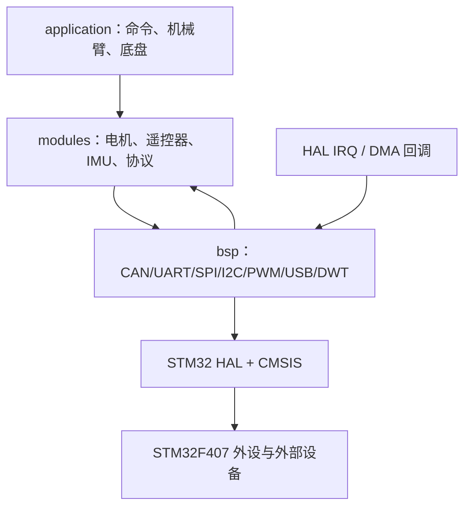

# 硬件驱动分层与阅读指南

> 本文解释“项目如何使用驱动”，不逐行展开 HAL、CMSIS 或 FreeRTOS 内核。所有实验建议默认断开动力输出；涉及电机、加热片或真实机构时，必须由有经验人员建立硬件急停和限能措施。

## 1. 驱动分层

**代码事实：** `RobotInit()` 先调用 `BSPInit()`，再初始化命令和机械臂/底盘设备；HAL 外设句柄由 CubeMX 文件提供，BSP 注册实例和回调，设备驱动完成协议换算，应用只操作目标/反馈结构（两工程 `application/robot.c:18-32`、`bsp/bsp_init.h:16-20`）。【已确认｜A级】

**原理解释：** 分层的价值是把“CAN 第几个字节”留在设备驱动，把“这个关节希望到多少角度”留在应用层。中断方向与调用方向相反：硬件事件先进入 HAL，再由 BSP 找到注册实例并调用设备解析。

**改进建议：** 新设备优先沿用“BSP 实例 + 设备解析 + daemon 在线监测”的边界；不要在应用任务里直接操作 HAL 句柄，除非明确记录原因。

## 2. 板级外设

| 外设 | 初始化与封装 | 中断/DMA入口 | 上层使用者 | 教学重点 | 可信度 |
| --- | --- | --- | --- | --- | --- |
| CAN1/CAN2 | `MX_CAN1_Init()` / `MX_CAN2_Init()`；`bsp/can/bsp_can.c` | `CANx_RX0/1_IRQHandler()` → `HAL_CAN_IRQHandler()` → FIFO 回调 | 四类电机、CANComm | 过滤器、标准/扩展帧、1 Mbit/s | 【已确认｜A级】 |
| USART1/3/6 | `MX_USARTx_UART_Init()`；`bsp/usart/bsp_usart.c` | DMA + `HAL_UARTEx_RxEventCallback()`；Error 回调重启 | 图传、遥控器、其他串口模块 | 空闲事件、长度、缓冲一致性 | 【已确认｜A级】 |
| SPI1/SPI2 | `MX_SPIx_Init()`；`bsp/spi/bsp_spi.c` | DMA/IT 完成回调释放 CS | BMI088 等 | CS 生命周期、同步/异步缓冲 | 【已确认｜A级】 |
| I2C2/I2C3 | `MX_I2C2/3_Init()`；`bsp/iic/bsp_iic.c` | HAL I2C 调用 | 独立编码器/传感器驱动痕迹 | 地址、超时、总线恢复 | 【已确认｜A级】 |
| TIM/PWM | TIM1/4/5/8/10 等；`bsp/pwm/bsp_pwm.c` | TIM IRQ/PWM compare | 舵机、BMI088 加热 | 频率、占空比、单位 | 【已确认｜A级】 |
| GPIO/EXTI | `MX_GPIO_Init()`；`bsp/gpio/bsp_gpio.c` | EXTI3/4/9_5 回调 | BMI088 DRDY/磁传感器线索 | 边沿、中断执行时间 | 【已确认｜A级】 |
| USB FS CDC | 默认任务 `MX_USB_DEVICE_Init()`；`bsp/usb/bsp_usb.c` | `OTG_FS_IRQHandler()` / CDC receive | 机械臂 `HostInit()` | 枚举、CDC 包边界 | 【已确认｜A级】 |
| DWT | `DWT_Init(168)` | 无普通 IRQ | PID、轨迹、INS 的 `dt` | 周期测量与溢出封装 | 【已确认｜A级】 |

### CAN 接收模型

**代码事实：** 第一个 CAN 实例注册时启动 CAN1/CAN2 并打开 FIFO0/FIFO1 pending 通知。HAL 回调读取报文后遍历注册表，匹配句柄和接收 ID，复制到实例缓冲并立即调用设备回调（两工程 `bsp/can/bsp_can.c:67-114,176-228`）。发送函数等待空邮箱直到成功或超时。【已确认｜A级】

**原理解释：** 电机反馈解析实际发生在中断上下文，因此越短越好；任务随后读取更新后的 `measure`。发送端忙等邮箱会占用当前任务时间，并可能拉长名义控制周期。

**改进建议：** 最终审查确认 FIFO 回调的 `while` 中匹配到一个实例后立即 `return`，列为 P2；需验证同一次 pending 中多帧积压的处理时延。中断和任务共享多字段结构时建议一致性快照。

### UART DMA + 空闲事件

**代码事实：** `USARTRegister()` 调用 `HAL_UARTEx_ReceiveToIdle_DMA()` 并关闭 half-transfer 通知；`HAL_UARTEx_RxEventCallback()` 把收到的 `Size` 交给 BSP 遍历逻辑，调用模块回调、清零已收部分并重启 DMA（`bsp/usart/bsp_usart.c:31-35,108-140`）。设备回调签名没有 `Size` 参数。【已确认｜A级】

**原理解释：** DMA 负责搬运字节，空闲中断负责指出一段数据暂时结束；DMA 不自动解决“这一帧有多长、是否完整、任务读到一半”的问题。

**改进建议：** 解析函数应使用实际长度或明确的帧状态机。当前模块只看固定字节和帧头，遇到短帧时存在读取旧缓冲内容的风险；图传失联回调只重启接收而不清键鼠状态，是安全审查重点。

## 3. 电机驱动

### 3.1 DJI 电机（底盘四轮）

| 项目 | 内容 |
| --- | --- |
| 驱动目录 | `Firmware/Engineer_chassis/modules/motor/DJImotor/` |
| 初始化函数 | `DJIMotorInit()`；应用实例在 `application/chassis/chassis.c:95-137` |
| 接收入口 | CAN FIFO 回调 → `DecodeDJIMotor()`（驱动内注册回调） |
| 核心结构体 | `DJIMotorInstance`、`DJIMotorMeasure_t`、`Motor_Controller_s` |
| 数据单位 | 编码器 0..8191；速度 rpm；电流和输出为 DJI 协议值；温度 °C |
| 上层使用者 | `MotorTask()`、`ChassisTask()`、功率控制 |
| 初学者实验建议 | 仅用录制 CAN 帧/离线单元测试验证端序、8192 回绕和方向；不通动力 |

**代码事实：** 反馈解析读取 ecd、速度、给定电流和温度；以 4096 为跨圈阈值累计圈数。四轮配置速度闭环，输出最终进入分组 CAN 帧（`dji_motor.c:71-120,281-342`；`chassis.c:95-137`）。【已确认｜A级】

**原理解释：** 编码器回绕必须在相邻采样差越过半圈时修正，否则累计角会突然跳 8192 计数。当前底盘速度环直接用 rpm 反馈，轮径没有进入活动轮速闭环换算。

**改进建议：** 先核对每轮 `motor_reverse_flag` 与抬轮方向，再验证轮速公式。禁止通过提高 PID 输出上限来“试方向”。

### 3.2 RS 电机（两板关节/相对角）

| 项目 | 内容 |
| --- | --- |
| 驱动目录 | 两工程 `modules/motor/RSmotor/` |
| 初始化函数 | `RSMotorInit()` |
| 接收入口 | CAN 扩展帧回调 |
| 核心结构体 | `RSMotorInstance`、`RSMotorMeasure_t` |
| 数据单位 | 角度 rad、速度 rad/s、力矩 N·m、温度 °C（按驱动换算） |
| 上层使用者 | 机械臂 `GimbalTask()`；底盘关节与 FOLLOW |
| 初学者实验建议 | 离线对边界值做 uint↔float 往返验证；不发送 enable/torque |

**代码事实：** 机械臂三台 RS、底盘三台 RS 均由应用配置闭环和 CAN 逻辑 ID。反馈重载 daemon；控制路径检查在线状态并构造扩展帧 MIT 风格命令（`RSmotor/rsmotor.c:56-165,174-335`）。【已确认｜A级】

**原理解释：** “角度—速度串级”发生在 MCU 软件，最终位置/速度/增益/力矩字段的实际驱动器行为还受电机协议固件影响。

**改进建议：** 需要 RS 型号手册确认范围、零点和上电使能语义；当前仓库只能确认代码换算，不能确认机械允许力矩。

### 3.3 DM4310（机械臂关节与底盘摇臂）

| 项目 | 内容 |
| --- | --- |
| 驱动目录 | 两工程 `modules/motor/DMmotor/` |
| 初始化函数 | `DMMotorInit()`，首次实例创建 `DMTask` |
| 接收入口 | CAN 标准帧回调；解析角度、速度、力矩、温度、错误码 |
| 核心结构体 | `DMMotorInstance`、`DMMotorMeasure_t` |
| 数据单位 | rad、rad/s、N·m、°C；协议位置/速度/力矩范围由驱动宏定义 |
| 上层使用者 | 机械臂 joint_3/4；底盘两摇臂 |
| 初学者实验建议 | 离线解一帧已知反馈并核对范围；不调用使能/清错命令 |

**代码事实：** 一个普通优先级任务轮询所有 DM 实例，每处理一个实例 `osDelay(1)`；两实例时单电机名义约 2 ms。正常 MIT 命令、使能/失能/清错命令共用 CAN，但 ID/数据不同（`dmmotor.c:89-118,147-215,289-363`）。【较可信｜B级】

**原理解释：** 任务周期取决于实例数量和执行时间，不是固定 1 ms。错误码虽解析到测量结构，上层未见把它统一升级为整机 STOP。

**改进建议：** 对错误码、掉线和恢复建立明确状态机；模式切换时统一 PID 状态。

### 3.4 LK4005（机械臂末端；底盘 LK9025 驱动未活动）

| 项目 | 内容 |
| --- | --- |
| 驱动目录 | 活动：机械臂 `modules/motor/LKmotor/LKmotor.c`；底盘 `LKmotor/LK9025.c` 仅为未调用驱动源码 |
| 初始化函数 | 活动 `LKMotorInit()` 只在机械臂 `GimbalInit()` 创建 joint_5/6 |
| 接收入口 | CAN A1 命令回包回调 |
| 核心结构体 | `LKMotorInstance` 与 measure 结构 |
| 数据单位 | 16-bit 编码器；角度 rad；速度换算为 rad/s；电流字段为协议值；温度 °C |
| 上层使用者 | 机械臂 joint_5/6；底盘两履带实际是 DJI M3508，不使用 LK9025 |
| 初学者实验建议 | 离线验证 65536 回绕、方向和速度换算；不发 A1 电流命令 |

**代码事实：** 活动机械臂 LK 以 32768 为半圈阈值累计编码器；joint_5 位置—速度串级、joint_6 速度单环（机械臂 `LKmotor.c:30-192`）。底盘虽包含 `LK9025.c`，`ChassisInit()` 实际用 `DJIMotorInit()` 创建 `motor_track_l/r`（底盘 `application/chassis/chassis.c:41,114-135`）。【已确认｜A级】

**改进建议：** 机械臂 LK 的 daemon 丢失回调没有让 `LKMotorControl()` 停止，可能继续使用旧反馈，是 P1。

## 4. BMI088 与 INS

| 项目 | 内容 |
| --- | --- |
| 驱动目录 | `modules/BMI088/`、`modules/imu/`、`modules/algorithm/QuaternionEKF.*` |
| 初始化函数 | `INS_Init()` → `BMI088Init()`；活动于底盘工程 |
| 接收入口 | SPI 读取与 EXTI 数据就绪线索；活动 `INS_Task()` 每轮主动 `BMI088_Read()` |
| 核心结构体 | `BMI088Instance`、`INS_t`、`attitude_t`、`QEKF_INS_t` |
| 数据单位 | 陀螺 rad/s、加速度 m/s² 线索、温度 °C、发布姿态 rad |
| 上层使用者 | `INSTask`、VisionSend；当前活动底盘跟随未用 IMU |
| 初学者实验建议 | 静止、断开动力，仅记录原始六轴、温度和姿态漂移；有经验人员监管加热 |

**代码事实：** `INS_Init()` 在 BMI088 初始化不成功时持续重试；配置四元数 EKF、温度 PID 和加速度低通。任务读取传感器、执行安装旋转、EKF 更新、去重力与坐标变换（底盘 `modules/imu/ins_task.c:42-169`）。【已确认｜A级】

**原理解释：** SPI 驱动提供字节，BMI088 驱动给出物理量，INS 才生成姿态；三层不能混为一谈。加热 PID 的输出是 PWM compare，不是机械电机命令，但仍可能使器件升温。

**改进建议：** 启动忙等缺少超时/降级状态；姿态坐标轴与实际安装方向缺少外部图纸，实机操作说明只能标为未确认。

## 5. 遥控器、图传键鼠与 USB

### 遥控器

| 项目 | 内容 |
| --- | --- |
| 驱动目录 | 两工程 `modules/remote/remote_control.*` |
| 初始化函数 | `RemoteControlInit()`，USART3，25 B 缓冲 |
| 接收入口 | UART DMA 空闲回调 → `RemoteControlRxCallback()` |
| 核心结构体 | `RC_ctrl_t` |
| 数据单位 | J1..J4 原始计数减 1024；SA..SD 代码值 |
| 上层使用者 | 两板 `RobotCMDTask()`；机械臂还生成板间命令 |
| 初学者实验建议 | 断开动力打印/调试观察结构体，逐通道记录中位、正负和失联 |

**代码事实：** 回调根据帧字节选择 WBUS/SBUS 解析；WBUS J1..J4 是 11-bit 字段，原值范围代码定义为 364..1684，中位 1024；绝对值超过 671 被判异常并置零。daemon 约 100 ms 未喂狗时清零遥控器结构（`remote_control.c:9-162`、`remote_control.h:37-47`）。【已确认｜A级】

**原理解释：** 代码通道名不等于物理摇杆标签；正负方向还取决于遥控器固件和机械安装。

**改进建议：** 正式操作指南必须用实机无动力记录确认 J1..J4、SA..SD 的物理布局和更新周期。

### 图传/裁判串口

| 项目 | 内容 |
| --- | --- |
| 驱动目录 | `modules/referee/rm_referee.c/.h` 等 |
| 初始化函数 | `ImgTransInit()`，机械臂 USART1 |
| 接收入口 | `ImgTransRxCallback()` → `RefereeReadData()` |
| 核心结构体 | 裁判数据、键鼠数据、自定义控制器数组 |
| 数据单位 | 协议定义；自定义控制器按 float 原始值 |
| 上层使用者 | `RobotCMDTask()`、UI/图传发送 |
| 初学者实验建议 | 用离线帧和 CRC 验证解析，不让命令进入 ENABLE |

**代码事实：** 解析 A5 裁判帧和 A9 53 字节键鼠/自定义帧；daemon 离线回调只重启 USART，未清保存的键鼠状态（`rm_referee.c:102-185,205-253`）。【已确认｜A级】

### USB CDC

**代码事实：** 默认任务启动 USB Device；机械臂 `HostInit()` 注册 CDC 接收并按自定义主机协议解析（`Src/freertos.c:122-130`、`modules/master_machine/host_communication.c:52-65`）。当前主要操作链没有证实 USB 命令优先于遥控器/键鼠。【较可信｜B级】

**改进建议：** 先用只读握手或日志验证端点；不要把 CDC 枚举成功等同于控制协议有效。

## 6. 独立编码器和其他模块

| 模块 | 代码位置 | 当前活动性 | 说明 |
| --- | --- | --- | --- |
| AS5600 | `modules/encoder/AS5600.c/.h` | 未找到业务初始化 | I²C 磁编码器驱动线索【已确认｜A级】 |
| MT6701 | `modules/encoder/MT6701.c/.h` | 未找到业务初始化 | 编码器驱动线索【已确认｜A级】 |
| MT6816 | `modules/encoder/MT6816.c/.h` | 未找到业务初始化 | 编码器驱动线索【已确认｜A级】 |
| IST 磁传感器 | `modules/ist8310/` | INS 路径存在接口/EXTI 线索，活动使用程度未完全确认 | 不据名称断言姿态融合【较可信｜B级】 |
| HC-05 | `modules/bluetooth/HC05.c/.h` | 未找到活动初始化 | 蓝牙串口驱动痕迹【已确认｜A级】 |
| TFmini Plus | `modules/TFminiPlus/` | 未找到主要控制链调用 | 测距驱动痕迹【较可信｜B级】 |
| 超级电容/功率模块 | `modules/super_cap/`、`power_control/` | 功率模型活动；外设实时反馈未确认 | 不能宣称有实时裁判功率闭环【已确认｜A级】 |
| OLED/日志 | BSP/模块目录 | 非控制核心；日志由编译宏禁用 | 调试能力依构建配置【已确认｜A级】 |

**原理解释：** “源文件存在”只证明仓库包含能力，不证明 PCB 装了设备或当前固件调用它。

**改进建议：** 判断设备活动性时必须沿“业务 Init → BSP 注册 → 回调/任务 → 上层消费者”完整追踪；独立编码器最适合做不驱动机构的总线读取实验，但仍须先确认硬件确实存在和电压兼容。

## 7. 初学者的驱动阅读顺序

1. 从应用实例配置读取句柄、ID、方向和 PID。
2. 跳到设备 `*Init()`，看它怎样注册 CAN/UART/SPI。
3. 找 BSP/HAL 回调，确认代码运行在中断还是任务。
4. 找设备解析回调，逐字段核对端序、范围和单位。
5. 找 `measure` 的消费者和 daemon 失联处理。
6. 最后再读发送打包；保持动力断开，用离线向量验证。

这条顺序能避免一开始陷入 HAL 内部实现，也能防止仅凭文件名误判设备正在使用。
