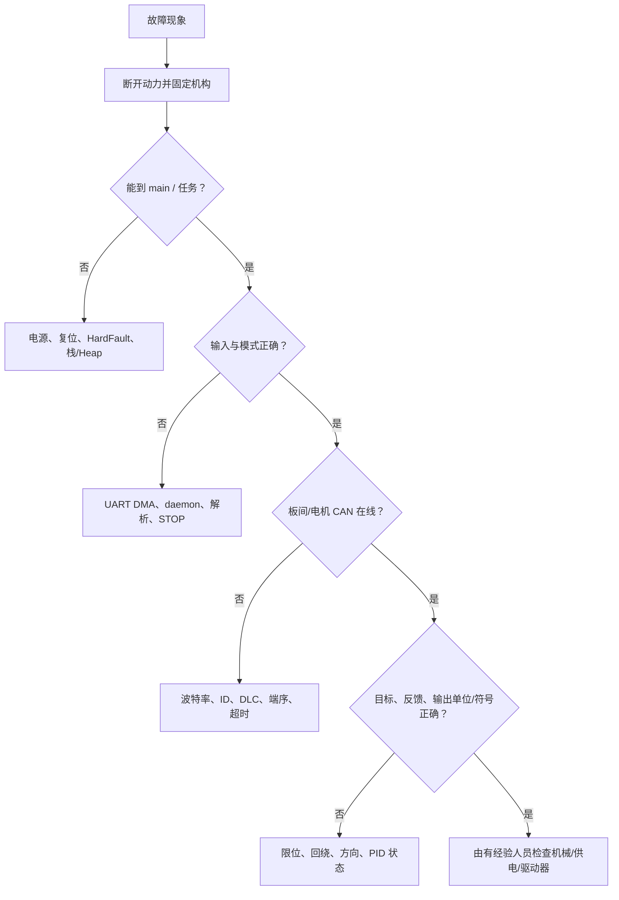

# 故障排查指南

> 排查顺序固定从“断能、观察、验证数据”开始。本文不建议通过增大 PID、输出上限或反复使能来定位故障。电机和机构相关步骤必须由有经验人员在硬件急停、限流和机械支撑条件下执行。

## 1. 通用诊断树

**代码事实：** 软件链上至少有遥控器/图传 daemon、CANComm daemon、电机 daemon、STOP/ENABLE 模式、目标限幅、PID 输出限幅和驱动停止标志，但这些机制并未形成统一故障管理器。【已确认｜A级】

**原理解释：** “无动作”可能是安全逻辑正常工作；“有反馈”也不等于单位/时间新鲜度正确。先在每个边界观察输入、模式、目标、反馈、输出，能快速找到证据链断点。

**改进建议：** 每次只验证一层，保留原始帧和变量时间戳。不要在断点暂停时让已使能机构无人看守。

## 2. 故障排查表

| 现象 | 可能原因 | 检查变量 | 检查接口 | 相关代码 | 建议步骤（由低风险到高风险） |
| --- | --- | --- | --- | --- | --- |
| 上电后无动作 | 正常 STOP；遥控器/板间/电机离线；初始化卡住；任务未创建 | `gimbal_mode/chassis_mode`、`motor_init_finish`、daemon 在线、任务句柄 | SWD；USART3；CAN1/2 | 两板 `EmergencyHandler()`；`robot.c:18-32`；`ins_task.c:80-118` | 断动力确认能到 `main()`/任务；检查 STOP 原因；观察接收帧与反馈；最后才由有经验人员检查驱动使能 |
| 上电后立即动作 | 默认/残留目标、初始化完成判断错误、STOP 未覆盖、驱动上电模式 | 模式、目标数组、各电机 `stop_flag/Ref` | SWD、只读 CAN 抓包 | 两板 `MotorCmdDataInit()`；arm `GimbalTask()`；chassis `ChassisTask()` | 立即硬件断能；不再复现动力；单步检查发布前目标和 STOP；核对未初始化局部计数及底盘预初始化使能 P0 |
| 电机方向错误 | `motor_reverse_flag`、轮速公式、编码器方向或机械安装不匹配 | `Ref`、`measure.speed/angle`、反向标志 | 手动转动时只读反馈；CAN | 各电机 Init；chassis `MecanumCalculate()` | 断能手动转动确认反馈符号；核对配置和公式；由有经验人员做极低限能单电机验证 |
| 电机高速旋转 | 反馈符号相反、单位错、编码器未更新、位置目标跨圈、PID 饱和 | `Ref/Measure/Err/Output/Iout`、在线状态、`dt` | SWD/只读 CAN | `controller.c:149-198`；各电机解析 | 立即硬停；保存现场后断动力；查反馈新鲜度/单位/符号；绝不先增大限幅或调增益 |
| 电机周期性抖动 | 相对延时漂移、CAN 堵塞、反馈滤波、积分/死区、结构间隙 | `dt`、输出、反馈时间、CAN error | DWT、CAN 分析仪 | `robot_task.h`；`bsp_can.c`；`controller.c` | 断能检查总线和周期；离线画目标/反馈；再由有经验人员低限能判断机械间隙 |
| 机械臂无法保持位置 | 未 ENABLE、位置环未启用、反馈掉线、力矩不足、重力补偿不存在 | 每关节模式、角/速 PID、`measure`、输出饱和 | SWD/CAN | `gimbal.c:352-439`; `05-arm-control.md` | 支撑机械臂；先证实位置目标与反馈；确认掉线；仓库没有重力补偿，不能盲目提高 Ki/MaxOut |
| 机械臂振荡 | 增益/符号/柔性、模式恢复积分、周期抖动、结构共振 | `Pout/Iout/Dout/Output/dt`、目标阶跃 | SWD/DWT/CAN | `controller.c`; RS/DM/LK Stop 实现 | 硬停并减能；离线分析波形；核对积分未统一清零；由有经验人员从速度环重新验证 |
| 底盘方向错误 | 四轮符号、物理轮型、反向标志、坐标旋转角符号 | `chassis_vx/vy/wz`、四轮 Ref、`arm_04_0.angle` | SWD/CAN | `chassis.c:288-349,392-454` | 抬轮断动力核对映射；确认真实轮型/CAD；逐轮低限能验证；不写正式方向结论前记录实测 |
| 遥控器无响应 | USART3 DMA 未启动、帧型不符、daemon 清零、SA 未满足使能 | `RC_ctrl_t`、Rx 缓冲、daemon、模式 | USART3 逻辑分析/SWD | `remote_control.c:35-162`; `bsp_usart.c` | 断动力观察原始25 B；验证帧头/长度/中位；看 daemon reload；最后检查模式条件 |
| 模式无法切换 | 拨杆编码/按键边沿不符、输入离线、自动事件优先、`motor_init_finish` 不可靠 | SA..SD、按键位、模式、event、busy | SWD/UART/CANComm | 两板 `RobotCMDTask()`/`EmergencyHandler()` | 只观察输入与条件分支；逐个列出进入条件；不要用强制改变量绕过 STOP |
| CAN 无反馈 | 波特率/终端/供电、总线选错、ID/帧型不匹配、过滤器/IRQ | CAN error、rx ID、DLC、daemon、measure 时间 | 隔离 CAN 分析仪、SWD | `.ioc`; `bsp_can.c`; 各电机回调 | 断能测终端和波形；确认1 Mbit/s与 CAN1/2；抓反馈 ID；再核对注册 ID/标准扩展帧 |
| CAN 报文错误 | 端序、DLC、范围压缩、板间分片/CRC、同 ID 冲突 | rx/tx buffer、CRC、ID、DLC | CAN 抓包 | `can_comm.c`; 四类电机驱动；`07-communication-protocols.md` | 保存原始帧；用离线脚本按发送端解码；再对照接收端；禁止重放力矩/使能帧 |
| IMU 数据异常 | BMI088 初始化失败、SPI/CS、安装旋转、温度、单位、EKF初值 | raw gyro/accel/temp、`dt`、quaternion、attitude | SPI/SWD | chassis `ins_task.c:80-169`; BMI088 驱动 | 静止断动力；先看原始六轴和温度，再看旋转后数据/EKF；确认初始化是否忙等 |
| 控制板频繁复位 | 供电跌落、HardFault、栈/Heap、看门狗不是原因、调试器复位 | RCC reset flags（当前未记录）、任务栈、Heap、fault 寄存器 | 示波器/SWD | `stm32f4xx_it.c` fault handlers；`FreeRTOSConfig.h` | 断动力测逻辑电源/NRST；调试器捕获 fault；检查栈/Heap；当前无硬件 watchdog，勿误判 |
| 任务停止运行 | 忙等待、栈溢出、创建失败、优先级抢占、阻塞发送 | 任务句柄/状态、stack high-water、Heap、`dt` | FreeRTOS-aware debugger | `INS_Init()`；`bsp_can.c` 发送；`robot_task.h` | 断能查看任务列表；确认是否卡在 BMI088 或 CAN 邮箱；当前缺少 hook，增加监测属后续改进 |
| HardFault | 非法指针/越界/栈损坏；自动 FSM size 越界是候选 | 堆栈帧、PC/LR/CFSR/HFSR/BFAR/MMFAR | SWD/GDB | `stm32f4xx_it.c`; `auto_action.c`/状态表 | 不复位覆盖现场；在 Handler 停住读取寄存器与栈；用 ELF `addr2line`；当前 Handler 不保存上下文 |
| 编译成功但运行无响应 | 烧错板固件、镜像/基址错误、卡初始化、日志被禁用、STOP 正常 | PC、模式、任务、镜像 hash | SWD/RTT/UART/CAN | 两工程同名 `build/ENGINEER.*`; Makefile `DISABLE_LOG_SYSTEM` | 核对工程目录/镜像；run-to-main；逐初始化断点；不要把无 RTT 输出当作未运行 |
| 两块控制板无法通信 | CAN1/CAN2 接错、ID/方向、CANComm CRC/长度、约500 ms超时 | CANComm online、收发 buffer、事件位、DLC | 两端 SWD + CAN 抓包 | 两端 `robot_cmd.c:121-132`; `can_comm.c` | 断动力确认物理总线；抓双向 ID；离线验证帧头/长度/CRC/帧尾；检查两端结构尺寸和版本 |

## 3. 重点代码级故障模式

### 3.1 自动状态表越界（P0）

**代码事实：** 机械臂状态数组约 24 项，底盘约 7 项，但初始化把 `fsm.size` 设为 47；状态推进可读取表外数据（两工程 `modules/fsm/auto_action.c` 与应用状态表）。【已确认｜A级】

**原理解释：** 越界读取可能表现为随机动作、HardFault、偶发正常或随编译选项变化，无法靠“多试几次”确认安全。

**改进建议：** 最终审查已确认两板 `fsm.size=47` 与 24/7 项实际表不一致。在修复、代码评审和断能测试完成前，不执行自动动作。

### 3.2 初始化完成标志不可靠（P0）

**代码事实：** 两板 `MotorInitHandler()` 使用未初始化的局部计数变量判断 `motor_init_finish`（机械臂 `application/cmd/robot_cmd.c:815-856`；底盘 `:516-543`）。【已确认｜A级】

**原理解释：** 栈上的不确定初值会让“所有电机已到位”的结论不可重复，可能过早使能或永远不完成。

**改进建议：** 最终审查确认两板局部 `isALLone` 未初始化，且底盘约 50 s 后可绕过反馈强制完成初始化。本阶段只记录问题，未改代码。

### 3.3 反馈过期仍被使用（P1）

**代码事实：** daemon 能标记掉线，但 LK 控制路径未统一以在线状态禁止输出；机械臂存活聚合也可能在单电机离线时仍维持整体工作。图传离线不清键鼠状态。【已确认｜A级】

**原理解释：** 闭环若把旧反馈当成新反馈，误差会保持或扩大，控制器可能继续输出。

**改进建议：** 故障复现先抓“最后一次反馈时间—最后一次命令—STOP 生效时间”的时间线；第四阶段审查所有输出路径是否真正受在线状态覆盖。

### 3.4 调度和共享数据（P1/P2）

**代码事实：** 所有周期任务用相对 `osDelay()`；PID 积分限幅使用跨实例共享的函数内 static 临时量；ISR 直接写测量结构，任务直接读，未见统一快照同步。【已确认｜A级】

**原理解释：** 这三点分别会造成周期漂移、可重入破坏和多字段撕裂。问题可能只在高 CAN 负载或 INS 抢占时出现。

**改进建议：** 用 DWT/RTOS trace 记录最坏周期与抢占；用离线压力测试复现。不要在带动力实机上靠提高日志量追竞态，因为日志本身会改变时序。

## 4. HardFault 最小证据集

当前 `HardFault_Handler()` 只是无限循环，没有保存 fault 上下文。调试器停住后应在复位前记录：PC、LR、SP、xPSR、CFSR、HFSR、MMFAR、BFAR、当前任务及其栈边界，再用本次烧录的 `.elf` 查符号。若只有 `.bin` 或镜像版本不匹配，定位可信度会显著下降。

## 5. 排查结束条件

只有同时满足以下证据，才可把某层排除：输入帧连续且长度/CRC正确；解析结构时间新鲜且值域合理；模式条件可逐项解释；目标有限幅；反馈单位/方向/回绕正确；输出在 STOP 和失联下为零或协议停机；任务周期和栈有测量；镜像与源码版本一致。
